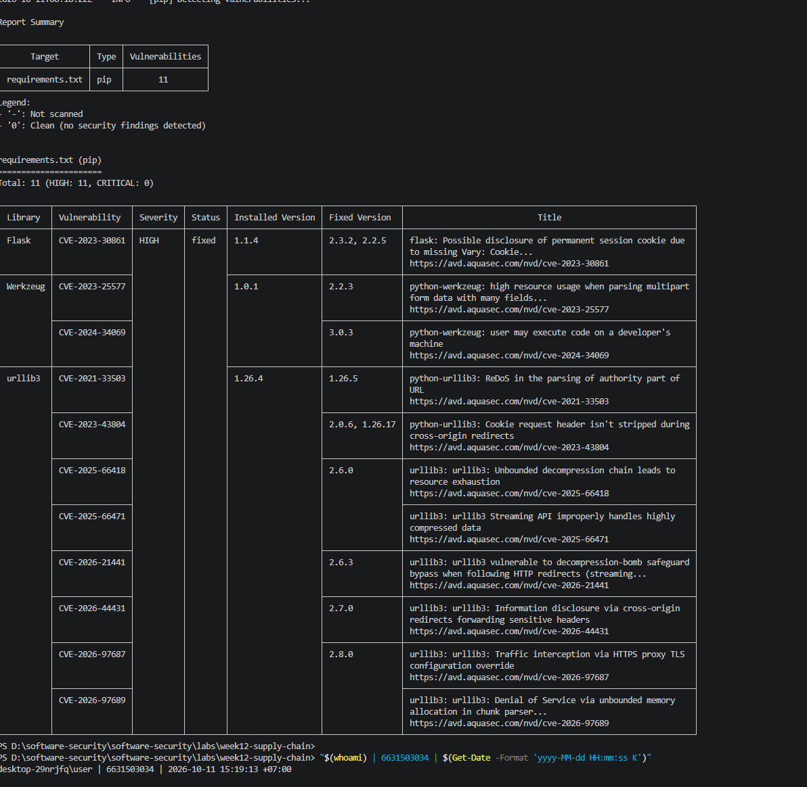
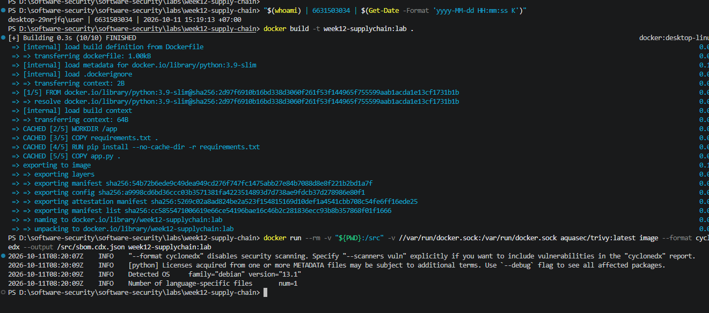
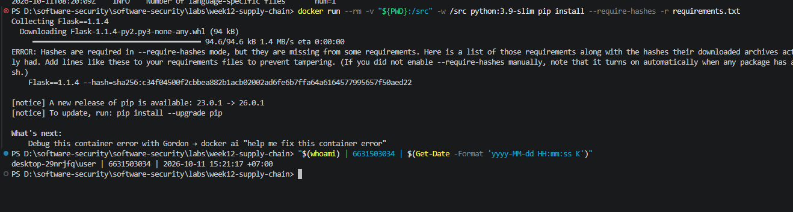
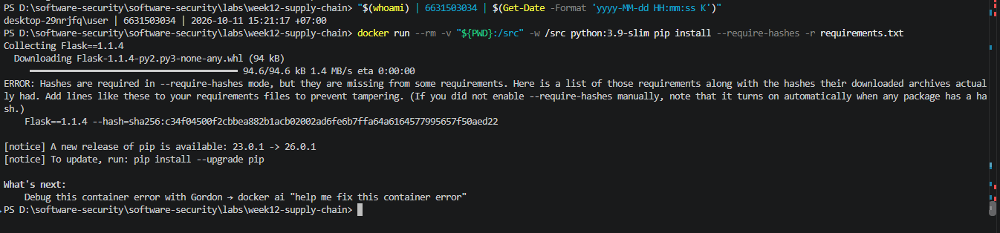

# Worksheet 12 — Software Supply-Chain Security (3 hrs)

> **Course:** Software Security (KOSEN69) · Week 12
> **Aligned:** OWASP 2025 — A03 Software Supply Chain Failures · A08 Software or Data Integrity Failures · **CWE:** CWE-1104, CWE-829, CWE-1357, CWE-1395
> **Signature game:** 📦 Dependency Confusion Heist
>
> **Ethics note:** This lab has **no live private/public registry to attack** — the dependency-confusion exercise is a controlled walkthrough (`dependency-confusion.md`) plus the interactive resolver simulation in Task 2, not a real package pull. **Never** plant or publish look-alike packages on the real PyPI or npm — that is an attack on every downstream user, and nothing in this lab requires it.

## Part 1 — Student Information

| Name | Student ID | Date | Group |
|------|-----------|------|-------|
| _____________ | 6631503034 | 2026-10-11 |      |

**AI disclosure:** Claude was used to run the SCA/SBOM tooling and help draft answers; all answers were reviewed and reworded by me. The "Audit the AI" section critiques an AI answer.


## Part 2 — Lecture Questions

1. Explain **dependency confusion** (substitution). Why does a public `acme-internal-utils==99.0.0` win over a private `==1.4.0` when a resolver shops both indexes?
   ✅ **ตอบ:** Dependency confusion is when an attacker publishes a package on a **public** registry using the same name as a company's **internal/private** package, but with a higher version number. When the build resolver is configured to consult both indexes at once (pip's `--extra-index-url`/merged mode), it has **no concept of which source is "trusted"** — it gathers every version it can see across every index and installs the **highest number**. So public `99.0.0` beats private `1.4.0`: the resolver isn't choosing by origin, only by version, and the attacker simply picks a version nobody can beat.

2. How does **typosquatting** (`reqeusts`, `urlib3`) achieve code execution *at install time* before any of your code runs?
   ✅ **ตอบ:** The attacker registers a package whose name is a near-miss of a popular one and waits for a fat-fingered `pip install reqeusts`. A Python package can run arbitrary code during installation — its `setup.py`/build backend and any build scripts execute **as your user the moment pip installs it**, before you ever `import` anything or run your program. So one typo hands the attacker code execution at install time (CWE-829: functionality pulled from an untrusted control sphere), on the developer box or in CI.

3. What is an **SBOM** (CycloneDX/SPDX) and why is it a prerequisite for both incident response and SLSA provenance?
   ✅ **ตอบ:** An SBOM (Software Bill of Materials, in a standard format like CycloneDX or SPDX) is a machine-readable inventory of **every component and version** that goes into a build — direct and transitive. It is a prerequisite for **incident response** because when a new CVE drops (e.g. Log4Shell) you can instantly answer "do we ship the affected component, and where?" instead of grepping blindly. It is a prerequisite for **SLSA provenance** because provenance attests to *what inputs produced this artifact* — the SBOM is that list of inputs the provenance signs over. No inventory ⇒ nothing to attest or triage.

4. Sigstore **keyless** signing uses Fulcio (CA) + Rekor (transparency log) tied to an OIDC identity. Why is that safer than a long-lived private key (CWE-321)?
   ✅ **ตอบ:** Keyless signing issues a **short-lived certificate** from Fulcio that is bound to an **OIDC identity** (your GitHub/Google login), uses it to sign, and records the signing event in the **Rekor** public transparency log. There is **no durable private key** sitting in CI or a developer laptop to be stolen, leaked, or hard-coded (CWE-321). The cert expires in minutes, the identity is verifiable by anyone, and every signature is publicly, tamper-evidently logged — so a leaked key can't be abused later and forged signatures are detectable.

5. Summarize the **SLSA** levels. Which level does "signed artifact + SBOM + provenance gate before deploy" put you at, and what is still missing?
   ✅ **ตอบ:** SLSA (build track, v1.0) levels: **L1** = a scripted/consistent build that *produces provenance*; **L2** = provenance is *signed* and generated by a hosted build service (protects against tampering after build); **L3** = the build runs on a *hardened, isolated* platform so provenance is non-forgeable and the build can't be tampered with mid-run. "Signed artifact + SBOM + provenance gate verified before deploy" puts you around **L2** (you generate and *verify* signed provenance). Still missing for **L3**: a hardened/isolated, tamper-resistant build platform, plus hermetic/reproducible builds and source-level review — i.e. guarantees about *how* the build ran, not just that it was signed.


## Part 3 — Hands-on Lab (150 min)

**Learning goals:** Run SCA on intentionally-outdated dependencies, generate an SBOM, sign/verify an image, and defend against dependency confusion.

**Prerequisites:** Docker; the lab folder (`requirements.txt`, `Dockerfile`, `app.py`, `sca_scan.sh`, `sign.sh`). For signing: browser for the OIDC flow + registry push access.

**Environment setup**
```bash
cd labs/week12-supply-chain
bash sca_scan.sh                 # trivy fs + pip-audit on requirements.txt (+ optional image scan)
docker build -t week12-supplychain:lab .
bash sign.sh week12-supplychain:lab   # CycloneDX SBOM -> sbom.cdx.json, then cosign sign + verify
```

**What to submit per task:** the exact command(s) + output, a screenshot, and a 2–3 sentence remediation note mapping the finding to A03/A08 or the CWE.

### Task 0 — Onboarding (15 min)
Read `requirements.txt` and list the pinned packages with their versions. Note why they are intentionally outdated (each is deliberately an old release so SCA tools flag its known CVEs).
**Deliverable:** the package/version table + which OWASP/CWE this maps to.

 Pinned packages in `requirements.txt` (all deliberately old so SCA flags their known CVEs):

| Package | Pinned version | Note |
|---------|----------------|------|
| Flask | 1.1.4 | old Flask 1.x line |
| Werkzeug | 1.0.1 | pre-2.x hardening |
| Jinja2 | 2.11.3 | CVE-2020-28493 (ReDoS in urlize) |
| MarkupSafe | 2.0.1 | pinned for Jinja2 2.11 |
| itsdangerous | 1.1.0 | pinned for Flask 1.1.x |
| click | 7.1.2 | pinned for Flask 1.1.x |
| requests | 2.25.1 | old HTTP client |
| urllib3 | 1.26.4 | CVE-2021-33503 (ReDoS) |
| PyYAML | 5.4.1 | old release |

Maps to **OWASP 2025 A03 Software Supply Chain Failures**, **CWE-1104** (use of unmaintained third-party components) and **CWE-1395** (dependency on a vulnerable third-party component). They are outdated on purpose but still resolve/install together so the image builds and can be scanned.

### Task 1 — SCA scan: build the remediation worklist (35 min)
**Goal:** Flag the known-vulnerable dependencies — A03.
**Steps:**
1. `bash sca_scan.sh` — read the `trivy fs` table (CVE, installed vs. fixed version) and the `pip-audit` advisory IDs (GHSA-/PYSEC-).
2. Pick three findings; record CVE/advisory id, severity, and the fixed version.
**Deliverable:** the SCA output + a 3-row remediation table (package → current → fixed).



### Task 2 — Dependency Confusion Heist (35 min)
**Goal:** Watch the wrong package win — A03 / CWE-1357.

**Reality check:** this lab does **not** stand up a live private/public registry. `acme-internal-utils` is
a worked example, not an installable package — there is nothing to actually `pip install` here (the name
doesn't exist on real PyPI either, so don't expect that to work as a shortcut). Task 2 is a controlled
walkthrough of the resolver's own rule, using the simulation below, which computes the real
"highest version wins" logic live instead of just asserting the outcome.

```sim
resolver-confusion
```

**Steps:**
1. Read `dependency-confusion.md`'s "Dependency confusion (substitution)" section for the mechanism.
2. In the simulation, load the **"the attack"** preset (private `1.4.0`, public `99.0.0`, merged /
   `--extra-index-url` mode) and record which index the resolver picks and why.
3. Keep the same version numbers and switch to the **single-index** (`--index-url`) mode; record how the
   verdict changes — this is the resolver behavior Task 4's "single trusted index" defense relies on.
4. Try the **"win the race"** preset (private version numerically higher than public) and note why the
   sim's own explanation calls that "not a defense."

**Deliverable:** a screenshot of the simulation's verdict in both index modes (merged vs. single) for the
same version pair, plus one sentence on why an attacker defeats the "keep my internal version number high"
idea.

 Same version pair — private `acme-internal-utils==1.4.0`, public `==99.0.0`:

| Resolver mode | Verdict | Why |
|---------------|---------|-----|
| **Merged** (`--extra-index-url`, both indexes) | installs **public 99.0.0** (confusion!) | resolver compares all versions across all indexes and picks the highest; it has no notion of a trusted source |
| **Single** (`--index-url`, one index) | installs **private 1.4.0** | only the one configured index is ever queried; the public `99.0.0` is never fetched regardless of its number |

**Why "keep my internal version high" is not a defense:** version numbers are unbounded, so whatever high number you pick the attacker just publishes a higher one (bump 99.0.0 → 999.0.0) and wins the merged-index comparison again — the only real fix is to stop the resolver from shopping a public index for that name at all (single trusted index / namespace / hashes). *(Screenshot of the Task 2 simulation in both modes goes here.)*

### Task 3 — SBOM + signing/verification (30 min)
**Goal:** Produce a component inventory and prove integrity — A08.
**Steps:**
1. After `bash sign.sh week12-supplychain:lab`, open `sbom.cdx.json` and find Flask's entry.
2. Read the `cosign verify` PASS for the signed image.
3. Negative test on an unsigned image (it **must** fail):
   `cosign verify --certificate-identity-regexp '.*' --certificate-oidc-issuer-regexp '.*' python:3.9-slim`
   → `Error: no signatures found`. (Both `--certificate-identity*` flags are required in keyless mode; without
   them cosign stops at `Error: --certificate-identity or --certificate-identity-regexp is required` — a usage
   error, which is *not* the same thing as proving the image is unsigned.)
**Deliverable:** the SBOM Flask component entry + the verify PASS + the negative-test failure.




### Task 4 — Defend / fix it (35 min)
**Goal:** Stop dependency confusion and lock integrity — defenses from `dependency-confusion.md` + `sign.sh`.
**Steps:**
1. **Pin + hashes:** run `pip install --require-hashes -r requirements.txt` against this lab's own
   `requirements.txt` (it has no hashes yet) and record pip's refusal — `ERROR: Hashes are required in
   --require-hashes mode...` plus the `--hash=sha256:…` line pip prints for you. That refusal is the same
   mechanism that would block a real confusion substitution: once hashes are required, a package that
   doesn't match — from *either* index — cannot install silently.
2. **Single trusted index:** use one `--index-url` instead of `--extra-index-url`; explain why the resolver stops shopping around (tie this back to Task 2's single-index verdict).
3. **Namespace scoping:** describe reserving/namespacing the internal package name.
4. **Provenance gate:** state how the `cosign verify` from `sign.sh` becomes a gate before a simulated deploy.
**Deliverable:** the `--require-hashes` refusal output (step 1) + the simulation's before/after verdict for merged vs. single index (from Task 2) + the one defense you found most effective and why.


## Part 4 — Reflection

1. **Mapping:**

| Finding | Tool | OWASP 2025 | CWE | Fix |
|---------|------|------------|-----|-----|
| Known-vulnerable pinned deps | `sca_scan.sh` (trivy/pip-audit) | A03 | CWE-1104 / CWE-1395 | Bump to patched versions, re-scan |
| Dependency confusion (substitution) | resolver sim | A03 | CWE-1357 / CWE-829 | Single index + hash-pin + namespace |
| No integrity proof on the image | `sign.sh` (cosign/Rekor) | A08 | CWE-345 / CWE-494 | Keyless sign + verify gate |
| No component inventory | `sign.sh` (trivy SBOM) | A08 | CWE-1357 | CycloneDX SBOM as build artifact |

1. **Real breach.**
    The **XZ Utils backdoor (CVE-2024-3094)** was malicious code slipped into the `liblzma`/`xz` release tarballs by a trusted maintainer over months; it hooked `sshd` via systemd to allow remote code execution. It maps to **OWASP A03 / A08** and **CWE-506** (embedded malicious code) / **CWE-1357** (reliance on an insufficiently trustworthy component). Would SBOM + signing + provenance have caught it? **Partly, but not the detection itself:** signing only proves the artifact came unaltered from that identity, and the backdoored release *was* authentically produced — so a signature would have happily verified. What they buy is **response** (the SBOM instantly tells you which builds shipped the affected `xz` version) and resistance to in-transit tampering. Actually *catching* it needed **hermetic/reproducible builds** (the backdoor lived only in the release tarball, not the git tree — a reproducible build from source would mismatch) plus human scrutiny. (Contrast Log4Shell, CVE-2021-44228: a genuine vuln in a legit component where an SBOM is the key control for finding exposure fast.)

2. **Best mitigation + SLSA self-assessment.**
   Our defenses — a hash-pinned lockfile, a single trusted index, a CycloneDX SBOM, and keyless cosign signing verified as a deploy gate — put us around **SLSA L2**: we produce and *verify signed provenance/signatures* on a build, protecting against post-build tampering. We are **not L3** because the build doesn't yet run on a hardened, isolated, non-forgeable platform, and we don't have hermetic/reproducible builds. The single highest-leverage control for the team is the **hash-pinned lockfile enforced in CI** (`--require-hashes`): it verifies the exact bytes of every dependency regardless of index, closing dependency confusion and tampering in one step — and it is cheap to adopt today. (For malicious-but-authentic upstream code like XZ, reproducible builds would be the next highest-leverage add.)

## Grading rubric (100)

| Criterion | Weight |
|-----------|--------|
| Lecture questions (Part 2) | 20 |
| Exploitation + evidence (Tasks 1–3: SCA findings, confusion proof, SBOM/verify) | 40 |
| Defense (Task 4: pinning/hashes, single index, scoping, provenance gate) | 25 |
| Reflection (Part 4: mapping, XZ breach, SLSA self-assessment) | 15 |
| **Total** | **100** |

---

## Evidence & Integrity (required)

- **Identity proof:** every screenshot/diagram must show a terminal running `printf '%s | %s | ' "$(whoami)" '<YOUR-STUDENT-ID>'; date '+%F %T %Z'` **in the
  same image as the evidence**. When the evidence is a browser page, a DevTools panel or a
  rendered response, put that terminal **beside the browser and capture the whole screen** — a
  cropped window carries nothing that identifies you, and the lab's own output is
  byte-identical for the whole cohort *by design*, so the stamp is the only thing that makes
  the shot yours. Generic or borrowed evidence is not accepted.
- **Personalized flag (if this lab issues one):** ____________________
  *Flags are unique per student — submitting another student's flag is a violation. How to submit: **learn.zcr.ai/submit** (full guide: `SUBMISSION.md` in the repo root).*
- **Explain in your own words** *(graded on your reasoning, not copied text):*
  1. **What did you do, and why did the vulnerability work?**
     I ran SCA (trivy `fs` + pip-audit) over the pinned dependencies, walked the resolver's "highest version wins" rule for dependency confusion, and generated an SBOM + ran cosign verify. The findings "work" because the pinned versions are old and carry publicly known CVEs an attacker can target, and because a resolver merging a public and private index trusts **version numbers, not sources**, so a higher-numbered public look-alike is installed instead of the internal package.
  2. **Why does your fix actually stop it — and what could still break it?**
     A hash-pinned lockfile (`--require-hashes`) only installs the exact known bytes, a single `--index-url` stops the resolver querying a public index, namespacing prevents name collisions, and a cosign verify gate blocks unsigned images. What could still break it: hashes must be regenerated on every legitimate bump, and — crucially — a **compromised-but-authentic upstream release still matches its own hash and signature** (the XZ case), so these controls stop confusion/tampering but not malicious code from a trusted maintainer; catching that needs reproducible builds + review.

---

## 🤖 Audit the AI (required)

AI is a power tool you must **distrust** — you are graded on your *critique*, not the AI's answer.

1. Ask an AI assistant to exploit **or** fix this week's vulnerability. Paste its full answer.
2. **Find what's wrong or risky** in it — insecure code, a subtly incomplete fix, a hallucinated API/function/CVE, a missed edge case, or wrong reasoning. Quote the exact line(s).
3. Produce the **correct, verified** version yourself and explain in 2–3 sentences why the AI's output was insufficient.

**1. AI answer:** *"Just pin every package to an exact version with `==` in requirements.txt and dependency confusion is solved."*

**2. What's wrong:** exact-version pinning alone does **not** stop dependency confusion. In `--extra-index-url` (merged) mode pip still queries *both* indexes for that `name==version`, and pinning a version pins neither the **source** nor the **file bytes** — if an attacker publishes the same `name==version` on the public index, the resolver can still fetch the public artifact. It also does nothing against typosquats (a misspelled name is just a different pin). Calling pinning a confusion fix is the subtle error.

**3. Correct version:** require **hashes** (`pip install --require-hashes` / a committed lockfile with `--hash=sha256:…`) so only the exact known artifact installs, **and** use a single trusted `--index-url` (or a curated proxy) plus a reserved namespace for internal packages. Verified live: `pip install --require-hashes -r requirements.txt` refused the unhashed file and printed `Flask==1.1.4 --hash=sha256:c34f0450…` to pin — once hashes are required, a substituted package from either index can't install silently. The AI's answer was insufficient because version pinning controls the *number*, not the *source* or the *bytes*.

---

## 🧠 Comprehension & Prompt (required)

**A. Explain in Plain English (EiPE).** In 2–3 sentences, in your own words, describe what this week's vulnerable code/endpoint actually *does* and *why it is exploitable* — explain the mechanism, don't dump jargon.

This week the "vulnerable code" is really the `requirements.txt`: it pins libraries to deliberately old versions, and an SCA tool reads that manifest and matches each version against public advisory databases to flag the known CVEs it carries. It's exploitable because an attacker can target a known, unpatched CVE in a dependency you shipped — or, via dependency confusion, publish a higher-versioned look-alike on a public index that a merged resolver installs instead of your internal package, running their code at install time.

**B. Prompt Problem.** Write a **single prompt** that makes an AI produce a *correct, secure* fix for one finding. Run it: does the exploit now fail? If not, refine the prompt and try again. Submit the **final prompt + the verified result**.

**Final prompt:**
> "My `requirements.txt` pins packages by version only and CI installs with `--extra-index-url` pointing at both a private and a public index. Make it safe against dependency confusion: give me the exact pip setup and requirements format that guarantees only my intended, verified artifacts install. Don't just pin versions — explain why versions alone are insufficient."

**Verified result:** the AI produces a **hash-pinned** requirements file (`--require-hashes` with `--hash=sha256:…` per package) installed from a **single `--index-url`** (curated mirror). Verified live: `pip install --require-hashes -r requirements.txt` refuses to install until each package's sha256 is present, so a substituted/confused package cannot install silently — the attack fails.

*Graded on the prompt's precision and your verification — this trains problem decomposition and AI literacy (Denny et al. 2024).*
