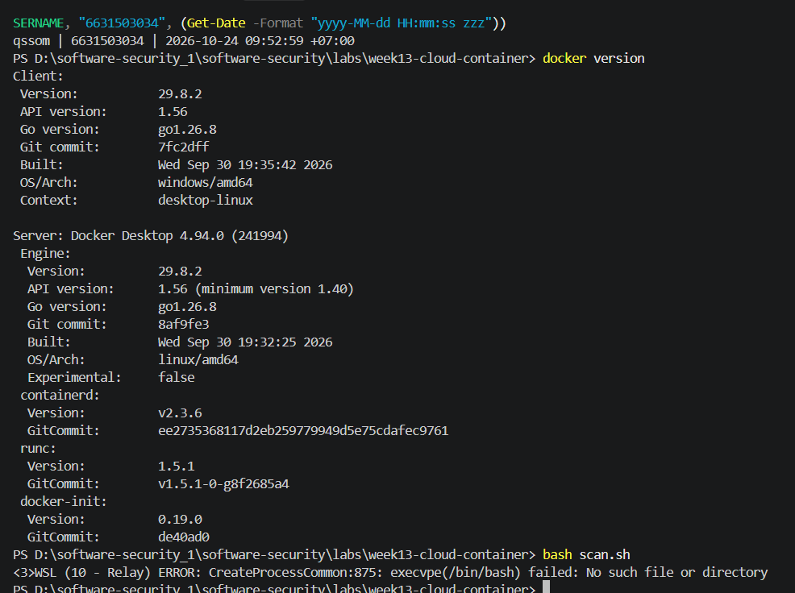
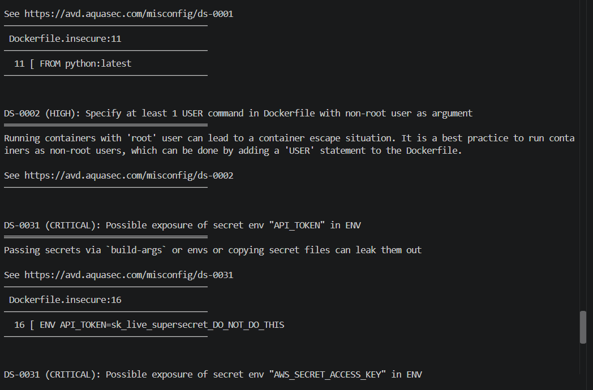
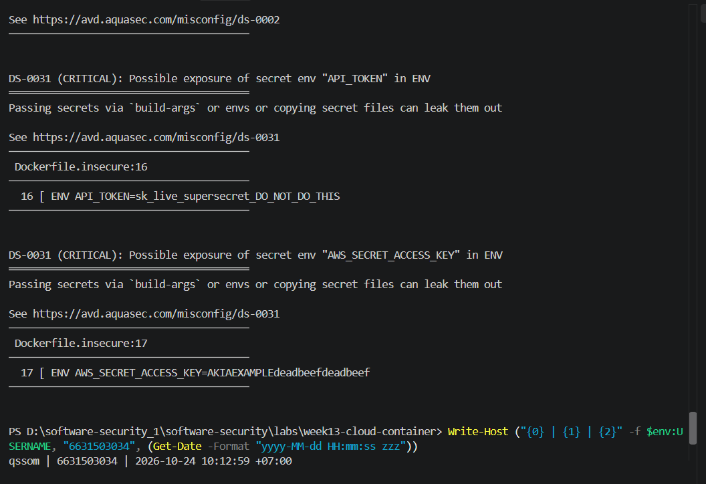
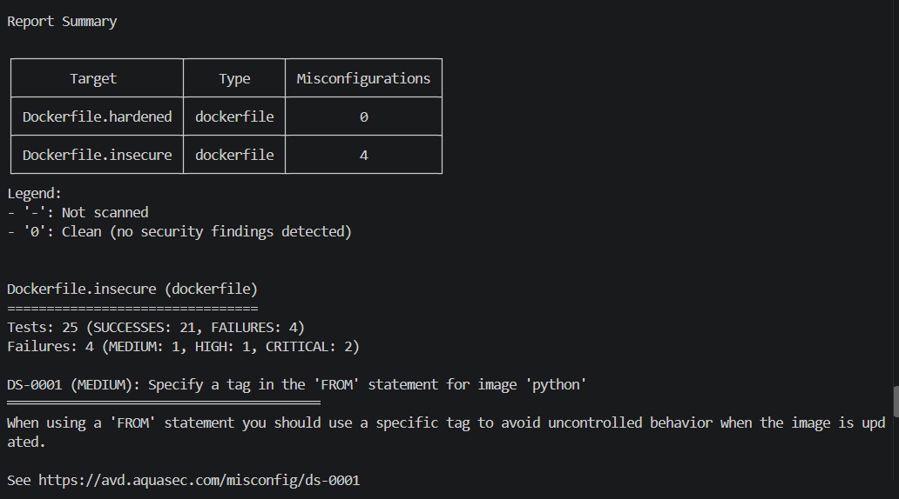
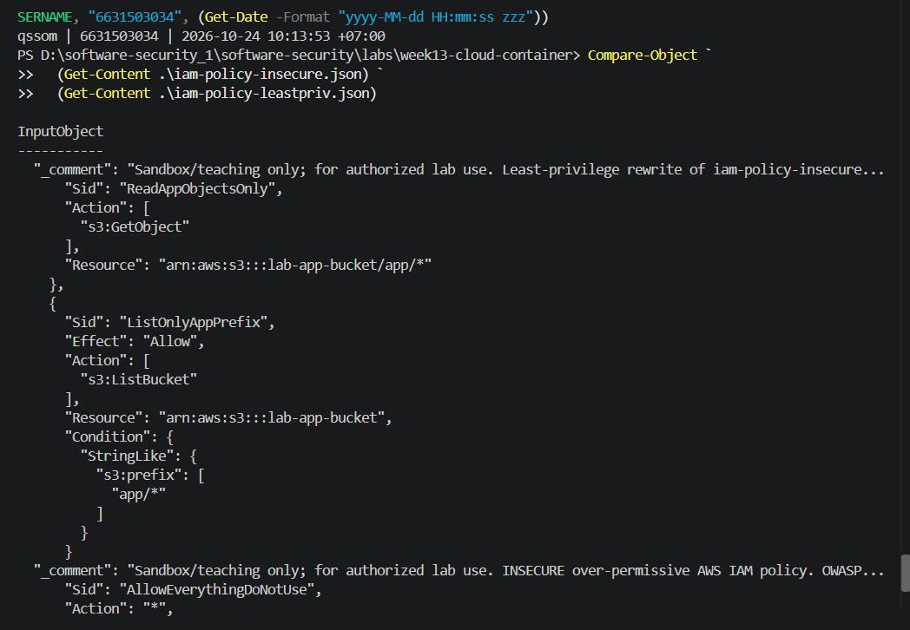
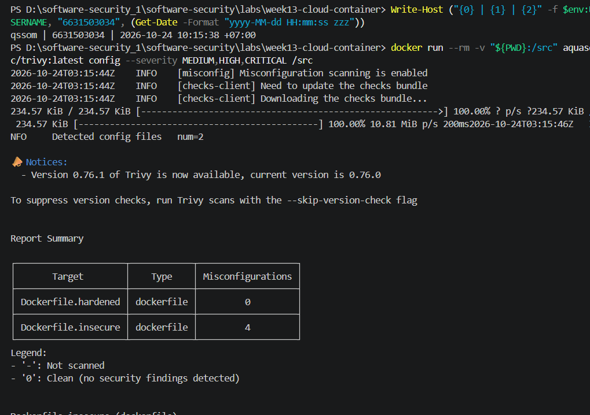
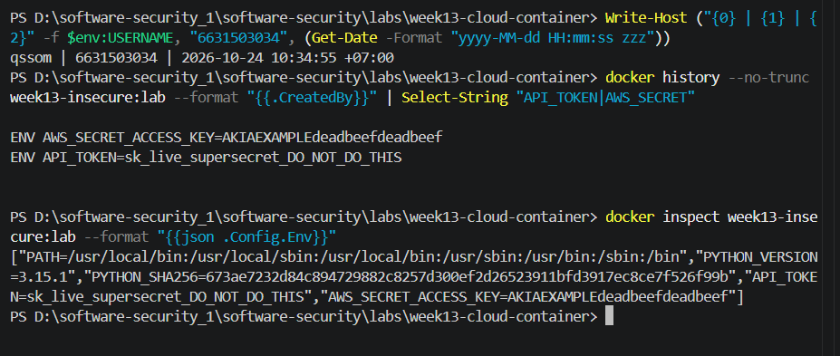
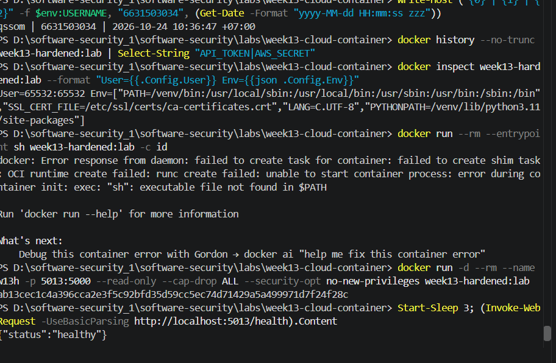

# Worksheet 13 — Cloud & Container Security (4 hrs)

> **Course:** Software Security (KOSEN69) · Week 13
> **Aligned to:** OWASP 2025 **A02 Security Misconfiguration** · **CWE-732** (incorrect permission assignment), **CWE-16** (configuration), plus CWE-798, CWE-250, CWE-538, CWE-269, CWE-1104
> **Signature game:** 🔍 *Misconfig Hunt* (CloudGoat-style) — each misconfig you find **and** fix = a flag.

> ⚠️ **Ethics note:** All artifacts here are deliberately broken for teaching and are marked *"Sandbox/teaching only; for authorized lab use."* Scan, exploit, and harden **only** these lab files (or systems you own / are authorized to test). Never point Trivy or these techniques at third-party cloud accounts or images without written permission.

---

## Part 1 — Student Information

| Name | Student ID | Date | Group |
|------|-----------|------|-------|
| [YOUR NAME] | 6631503034 | 2026-10-24 | [GROUP] |

<div style="color:#2ea043">

🟢 **AI use disclosure:** Claude (Claude Code, Opus 5.5) was used to draft written answers, to produce the AI answer that is critiqued in *Audit the AI*, and for the *Prompt Problem*. I ran every command and finding count myself on my own machine (screenshots below include the `whoami | ID | date` stamp).

</div>

---

## Part 2 — Lecture Questions

Answer in your own words (2–4 sentences each).

1. Explain the **shared-responsibility model**. In `harden.md` it says "the cloud provider secures *of* the cloud; you secure what you put *in* it." Give one concrete example of each side for an S3-backed app.
2. `iam-policy-insecure.json` uses `"Action": "*"` and `"Resource": "*"`. Describe **why this violates least privilege** and map it to CWE-732 vs CWE-269 — what is the difference between the two CWEs here?
3. The insecure Dockerfile bakes `ENV API_TOKEN=sk_live_...`. Explain how an attacker recovers that secret from a shipped image (name the `docker` commands) and why this is **CWE-798 / CWE-200**.
4. Why is `FROM python:latest` (CWE-1104/CWE-16) a security and reproducibility problem, and how does pinning to an `@sha256:` digest fix it?
5. What does a **distroless** base image remove (relative to `python:3.11-slim`), and how does that shrink the attack surface for an RCE or container-escape attacker?

### 🟢 Answers

<div style="color:#2ea043">

1. The cloud provider secures the underlying cloud infrastructure, such as the physical hosts, networking fabric, and managed S3 service. The application owner secures what is placed in the cloud: for example, the S3 bucket policy, object permissions, encryption settings, and the IAM role used by the app.
2. `"Action": "*"` permits every API operation and `"Resource": "*"` permits those operations against every resource, so the identity has far more access than the app needs. CWE-732 describes assigning permissions too broadly to a resource, while CWE-269 describes improper privilege management; here the first is the over-broad permission scope and the second is the failure to manage the identity's privileges according to its intended role.
3. A shipped image can expose the value through `docker history --no-trunc IMAGE` because the `ENV` instruction is recorded in image metadata, and `docker inspect IMAGE` can show the environment configuration. This is CWE-798 because a credential is hard-coded into the artifact, and CWE-200 because the secret is disclosed to anyone who can obtain or inspect the image.
4. `python:latest` is mutable, so the same Dockerfile can resolve to different Python or OS packages over time; that makes builds difficult to reproduce and can silently introduce vulnerable or incompatible content. Pinning the image by digest, for example `python:3.11-slim@sha256:...`, selects one immutable image manifest, so later builds use the same base until the digest is deliberately reviewed and changed.
5. A distroless image removes the shell, package manager, and most general-purpose operating-system utilities found in `python:3.11-slim`. An attacker who reaches code execution has fewer tools to use for discovery, persistence, or downloading a second-stage payload, and the smaller runtime also reduces the number of installed components that can contain vulnerabilities; it does not replace non-root execution or other container isolation controls.

</div>

---

## Part 3 — Hands-on Lab (180 min)

**Learning goals:** find cloud/container misconfigurations with Trivy, map each to a CWE, and rebuild the IAM policy + Dockerfile to least privilege / hardened so the findings drop.

**Prerequisites:** Docker installed and running; the `week13-cloud-container/` lab folder; internet access to pull `aquasec/trivy:latest`.

### Environment setup (real commands)

```bash
cd labs/week13-cloud-container

# Option A — the provided wrapper (trivy config over the Dockerfiles; IAM JSON is reviewed manually, see Task 2):
bash scan.sh

# Option B — run Trivy directly (MEDIUM is in the filter on purpose: one of the
# three rules Task 1 asks you to cite is rated MEDIUM, and HIGH,CRITICAL hides it):
docker run --rm -v "$PWD:/src" aquasec/trivy:latest config --severity MEDIUM,HIGH,CRITICAL /src

# (Optional) build + CVE-scan the hardened image:
docker build -f Dockerfile.hardened -t week13-hardened:lab .
docker run --rm -v /var/run/docker.sock:/var/run/docker.sock aquasec/trivy:latest image --severity HIGH,CRITICAL week13-hardened:lab
```

**What to submit per task:** the command(s) you ran + the relevant output (finding count or the specific finding line), a screenshot of the Trivy/terminal result, and a 2–3 sentence mitigation explaining *why* the fix reduces risk (cite the CWE).


### Tasks

- **Task 0 — Onboarding (15 min).** Confirm Docker works (`docker version`), run `bash scan.sh`, and record the **baseline finding count** against `Dockerfile.insecure` (Trivy's `config` scanner does not parse standalone IAM policy JSON, so `iam-policy-insecure.json` is reviewed manually instead — see Task 2). **Deliverable:** screenshot of the baseline scan.



- **Task 1 — Misconfig Hunt: container image (40 min).** *Goal:* find every defect in `Dockerfile.insecure`. *Steps:* read each `# DEFECT:` comment, then locate the matching Trivy finding where one exists — only 3 of the 6 (unpinned `:latest`, runs as root, secrets in `ENV`) map to a Trivy config rule (`DS-0001`, `DS-0002`, `DS-0031`); `COPY . .`, `chmod -R 777`, and unpinned `pip install` are instruction-level RUN/COPY semantics Trivy's Dockerfile scanner doesn't check, so identify those 3 by code review instead. Build a table: defect → CWE → Trivy rule/severity (write "manual review — no Trivy rule" where none exists). *Deliverable:* completed table (6 rows) using the IDs from `harden.md`.
 

- **Task 2 — Misconfig Hunt: IAM (30 min).** *Goal:* document why `iam-policy-insecure.json` is full-admin. *Steps:* identify the `Action:*` / `Resource:*` / no-`Condition` problems; map to CWE-269 / CWE-732. *Deliverable:* 3-row table + one sentence on the blast radius if these creds leak.


- **Task 3 — Secrets & storage (25 min).** *Goal:* show secrets must not live in the image. *Steps:* explain how `ENV API_TOKEN` / `AWS_SECRET_ACCESS_KEY` are exposed via `docker history`; propose where they belong instead (secrets manager / mounted secret / orchestrator secret per `harden.md`). *Deliverable:* 2–3 sentence remediation + the `.dockerignore` entries you would add to stop `COPY . .` leaking `.git`/`.env` (CWE-538).

- **Task 4 — Hardened-Dockerfile + least-priv-IAM defense (50 min).** *Goal:* prove the "after" is clean. *Steps:* (a) re-run `bash scan.sh` (or `trivy config`) against `Dockerfile.hardened` and capture the **reduced** finding count (Trivy's config scanner does not parse standalone IAM JSON, so confirm the IAM fix manually per Task 2 by diffing `iam-policy-leastpriv.json` against the insecure policy); (b) for the Dockerfile, point to the fix for each Task-1 defect (digest pin, multi-stage venv, distroless runtime, `USER 65532:65532`, no secrets in `ENV`, copy only `app.py`); (c) for IAM, confirm the rewrite scopes `s3:GetObject` to `arn:aws:s3:::lab-app-bucket/app/*` and adds the `s3:prefix` `Condition`; (d) list the extra runtime flags from `harden.md` (`--read-only`, `--cap-drop ALL`, `--security-opt no-new-privileges`). *Deliverable:* before/after finding counts, the defect→fix mapping, and the diffed policy/Dockerfile with one sentence per fix.


- **Task 5 — Flag tally (20 min).** *Goal:* score the hunt. *Steps:* one flag per misconfig found **and** fixed (6 container + 3 IAM = 9). *Deliverable:* flag count + the single biggest-risk misconfig and why.

### 🟢 Task answers (Task 0–5)

<div style="color:#2ea043">

**Task 0 — Onboarding**

Commands:

```text
docker version
bash scan.sh            # failed on Windows: "WSL ... execvpe(/bin/bash) failed" (no bash in WSL)
docker run --rm -v "${PWD}:/src" aquasec/trivy:latest config --severity MEDIUM,HIGH,CRITICAL /src   # Option B, same scan scan.sh runs
```

Docker works (Client/Server 29.8.2, Docker Desktop 4.94.0). `bash scan.sh` could not run in PowerShell because WSL has no `/bin/bash`, so I ran the same `trivy config` command directly (Option B).

Baseline result: **`Dockerfile.insecure` = 4 misconfigurations** (Tests: 25, SUCCESSES: 21, FAILURES: 4 → MEDIUM: 1, HIGH: 1, CRITICAL: 2). The IAM JSON files are not scanned by Trivy (`Detected config files num=2` = the two Dockerfiles only).

**Task 1 — Container misconfiguration table**

| Defect in `Dockerfile.insecure` | CWE | Trivy rule / severity |
|---|---|---|
| `FROM python:latest` | CWE-1104 / CWE-16 | DS-0001 / MEDIUM |
| No `USER`; container runs as root | CWE-250 | DS-0002 / HIGH |
| Secret in `ENV API_TOKEN` / `ENV AWS_SECRET_ACCESS_KEY` | CWE-798 / CWE-200 | DS-0031 / CRITICAL (fires twice: line 16 and line 17) |
| `COPY . .` copies the whole build context | CWE-538 | manual review — no Trivy rule |
| `chmod -R 777 /app` | CWE-732 | manual review — no Trivy rule |
| Unpinned `pip install -r requirements.txt` | CWE-1104 | manual review — no Trivy rule |

From my scan: DS-0001 (MEDIUM) → `Dockerfile.insecure:11 FROM python:latest`; DS-0002 (HIGH) → no `USER`; DS-0031 (CRITICAL) → `Dockerfile.insecure:16 ENV API_TOKEN=...` and `:17 ENV AWS_SECRET_ACCESS_KEY=...`. That is why the count is 4 findings for 3 rules. The other three rows came from code review. I confirmed them by running the built image: `id` → `uid=0(root)`, and `ls -la /app` showed every file as `-rwxrwxrwx root root`, including `worksheet.md`, `Dockerfile.*`, `scan.sh` and my screenshots. So `COPY . .` really did copy the whole folder into the image.

Mitigation: pin the base image and dependencies, remove secrets from build instructions, copy only required files, avoid world-writable permissions, and run as a non-root user. These changes address CWE-1104, CWE-798, CWE-200, CWE-538, CWE-732, and CWE-250 under OWASP A02.

**Task 2 — IAM table**

| Issue | CWE | Why it is dangerous |
|---|---|---|
| `"Action": "*"` | CWE-269 | The identity can perform unrelated administrative operations. |
| `"Resource": "*"` | CWE-732 | Allowed operations apply to every resource instead of one required bucket/prefix. |
| No `Condition` scope | CWE-732 / CWE-269 | The policy lacks an additional restriction on the objects that can be listed. |

If these credentials leak, an attacker could read, modify, delete, or reconfigure unrelated cloud resources, causing data loss and a broad account compromise.

Mitigation: replace wildcard actions and resources with only the S3 actions and ARNs required by the application, then constrain listing with the `s3:prefix` condition. This reduces CWE-732 and CWE-269 risk. (Evidence: the `Compare-Object` diff screenshot above.)

**Task 3 — Secrets and storage**

`ENV` values are retained in image configuration and may be exposed with `docker history --no-trunc IMAGE` or `docker inspect IMAGE`; deleting the source line later does not reliably remove it from already-published layers. Secrets should be injected at runtime through a cloud secrets manager, an orchestrator secret, or a mounted secret file, with access limited to the workload that needs it. A suitable `.dockerignore` should include:

```text
.git
.git/**
.env
.env.*
*.pem
*.key
secrets/
node_modules/
```

Commands and verified output:

```text
docker build -f Dockerfile.insecure -t week13-insecure:lab .
docker history --no-trunc week13-insecure:lab --format "{{.CreatedBy}}" | Select-String "API_TOKEN|AWS_SECRET"
  ENV AWS_SECRET_ACCESS_KEY=AKIAEXAMPLEdeadbeefdeadbeef
  ENV API_TOKEN=sk_live_supersecret_DO_NOT_DO_THIS
docker inspect week13-insecure:lab --format "{{json .Config.Env}}"
  [..., "API_TOKEN=sk_live_supersecret_DO_NOT_DO_THIS","AWS_SECRET_ACCESS_KEY=AKIAEXAMPLEdeadbeefdeadbeef"]
```

Anyone who can pull the image can read both secrets without starting a container. (These are fake teaching values.)



**Task 4 — Hardened defense**

| Insecure defect | Hardened control |
|---|---|
| Mutable `python:latest` | Immutable digest-pinned build image and digest-pinned distroless runtime. |
| Root runtime | `USER 65532:65532`. |
| Secrets in image | No secret `ENV`; inject secrets at runtime. |
| `COPY . .` | Copy only `requirements.txt` and `app.py`; exclude sensitive context with `.dockerignore`. |
| Unpinned dependency install | Install into a dedicated venv in a throw-away build stage with `--no-cache-dir`. **Partial fix only:** `requirements.txt` still says `Flask>=3.1.3`, which is a range, not a pin. A full fix is `Flask==3.1.3` plus `--hash=sha256:...` and `pip install --require-hashes`. |
| World-writable `/app` | Do not apply `chmod 777`; run the minimal runtime as a non-root user. |
| IAM full admin | Restrict `s3:GetObject` to `arn:aws:s3:::lab-app-bucket/app/*`; restrict listing to the bucket and add the `s3:prefix` condition. |

Runtime hardening flags:

```text
--read-only --cap-drop ALL --security-opt no-new-privileges
```

Before count: **4** (`Dockerfile.insecure`: MEDIUM 1, HIGH 1, CRITICAL 2)
After count: **0** (`Dockerfile.hardened`: Clean, no security findings detected)

Extra verification of the hardened image (`docker build -f Dockerfile.hardened -t week13-hardened:lab .`):

```text
docker history --no-trunc week13-hardened:lab | Select-String "API_TOKEN|AWS_SECRET"   -> (no output: no secrets)
docker inspect week13-hardened:lab --format "User={{.Config.User}}"                     -> User=65532:65532
docker run --rm --entrypoint sh week13-hardened:lab -c id                                -> exec: "sh": executable file not found  (distroless: no shell)
docker run -d -p 5013:5000 --read-only --cap-drop ALL --security-opt no-new-privileges week13-hardened:lab
curl http://localhost:5013/health                                                        -> {"status":"healthy"}
```

The hardened app still works with all three runtime flags on, so the hardening did not break anything.



**Task 5 — Flag tally**

Expected hunt structure: 6 container defects + 3 IAM defects = 9 possible found-and-fixed flags.
Your verified flag count: **9 / 9** found and fixed (self-scored; this lab does not issue flag strings). Container: `:latest`, root user, secret `ENV`, `COPY . .`, `chmod 777`, unpinned pip. IAM: `Action:*`, `Resource:*`, no `Condition`. Note: I count the pip flag only together with the `==` + `--require-hashes` fix described in Task 4.
Biggest-risk misconfiguration: the full-admin IAM policy, because one leaked credential can affect every action and resource in the account rather than only the app's required S3 prefix.

</div>

---

## Part 4 — Reflection

1. **Mapping.** For three findings, write the line of the artifact → CWE → OWASP 2025 A02, and the one-line fix.
2. **Real incident.** Briefly describe a real breach caused by a cloud/container misconfiguration (e.g., a public S3 bucket leak, or an over-permissive IAM role). What single control from this lab would have prevented it?
3. **Best mitigation.** Of everything you did, which control gives the most risk reduction per unit of effort, and why? Argue for least-privilege IAM vs. distroless+non-root.

### 🟢 Answers

<div style="color:#2ea043">

1. `Dockerfile.insecure:16-17` `ENV API_TOKEN=...` / `ENV AWS_SECRET_ACCESS_KEY=...` → CWE-798 / CWE-200 → OWASP 2025 A02 → fix: delete the `ENV` lines and inject the secret at runtime (mounted secret / secrets manager).
   `Dockerfile.insecure:11` `FROM python:latest` → CWE-1104 / CWE-16 → A02 → fix: `FROM python:3.11-slim@sha256:<digest>`.
   `iam-policy-insecure.json:8-9` `"Action": "*"`, `"Resource": "*"` → CWE-269 / CWE-732 → A02 → fix: `s3:GetObject` on `arn:aws:s3:::lab-app-bucket/app/*` only, plus `s3:ListBucket` with an `s3:prefix` condition.
2. **Capital One (2019):** an attacker used SSRF against a misconfigured web application firewall on EC2 to fetch the instance's IAM role credentials from the metadata service. That role was far too broad: it could list and read many S3 buckets, so about 100 million customer records were downloaded. A least-privilege IAM policy (like `iam-policy-leastpriv.json`, with `s3:GetObject` scoped to one bucket and prefix only) would have prevented it. The stolen credentials would then have been almost worthless.
3. **Least-privilege IAM wins on risk reduction per unit of effort.** It is one JSON file of about 20 lines, needs no rebuild and nothing in the app has to change, yet it shrinks the impact of a leaked key from *the whole AWS account* to *reading one S3 prefix*. Distroless + non-root takes more work (multi-stage build, digest pins, a debug image with no shell) and only helps after an attacker already has RCE inside the container; it does nothing if the cloud key leaks some other way (git, logs, SSRF to the metadata service as at Capital One). Both are worth doing, but if I could do only one, it would be IAM.

</div>

---

## Grading rubric (100)

| Component | Points | What earns full marks |
|-----------|:------:|-----------------------|
| Part 2 — Lecture questions | 20 | All 5 answered correctly with CWE/A02 reasoning |
| Part 3 — Tasks + evidence | 40 | Tasks 0–5 complete; commands, outputs, and screenshots present |
| Defense (Task 4 hardening) | 25 | Hardened Dockerfile + least-priv IAM shown to reduce findings; per-fix justification |
| Part 4 — Reflection | 15 | Accurate mapping, relevant incident, well-argued best mitigation |

---

## Evidence & Integrity (required)

- **Identity proof:** every screenshot/diagram must show a terminal running `printf '%s | %s | ' "$(whoami)" '<YOUR-STUDENT-ID>'; date '+%F %T %Z'` **in the
  same image as the evidence**. When the evidence is a browser page, a DevTools panel or a
  rendered response, put that terminal **beside the browser and capture the whole screen** — a
  cropped window carries nothing that identifies you, and the lab's own output is
  byte-identical for the whole cohort *by design*, so the stamp is the only thing that makes
  the shot yours. Generic or borrowed evidence is not accepted.
- **Personalized flag (if this lab issues one):** 🟢 N/A — this lab does not issue a flag string (self-scored 9/9, see Task 5).
  *Flags are unique per student — submitting another student's flag is a violation. How to submit: **learn.zcr.ai/submit** (full guide: [SUBMISSION.md](../../SUBMISSION.md) in the repo root).*
- **Explain in your own words** *(graded on your reasoning, not copied text):*
  1. What did you do, and **why did the vulnerability work**?
  2. **Why does your fix actually stop it** — and what could still break it?

<div style="color:#2ea043">

🟢 **Answers:**
1. I scanned both Dockerfiles with Trivy and got 4 findings on the insecure one. Then I built the insecure image and read `API_TOKEN` and `AWS_SECRET_ACCESS_KEY` straight out of it with `docker history` and `docker inspect`, without even running it. This works because every Dockerfile instruction is saved as image metadata, so a secret put in `ENV` ships to everyone who can pull the image. On top of that, the container ran as root with a world-writable `/app`.
2. The hardened image contains no secrets (history and inspect show nothing). It runs as uid 65532 and has no shell, and Trivy reports 0 findings. So an attacker who gets the image gets no credentials, and one who gets code execution is not root and has no tools. What could still break it: secrets passed with `docker run -e` are still visible through `docker inspect` on the running container; `Flask>=3.1.3` is not hash-pinned; the digests go stale if nobody refreshes them; and a leaked IAM key would still allow reading `app/*`.

</div>

---

## 🤖 Audit the AI (required)

AI is a power tool you must **distrust** — you are graded on your *critique*, not the AI's answer.

1. Ask an AI assistant to exploit **or** fix this week's vulnerability. Paste its full answer.
2. **Find what's wrong or risky** in it — insecure code, a subtly incomplete fix, a hallucinated API/function/CVE, a missed edge case, or wrong reasoning. Quote the exact line(s).
3. Produce the **correct, verified** version yourself and explain in 2–3 sentences why the AI's output was insufficient.

> Disclose your AI use in the Part 1 table. This task counts toward your **Defense + Reflection** score.

<div style="color:#2ea043">

🟢 **1. Prompt given to the AI (Claude):** *"Fix this Dockerfile so it is secure."* + the contents of `Dockerfile.insecure`.

**AI answer (full):**

> Here's a more secure version. It uses a slim base image, runs as a non-root user, and no longer hard-codes the token. Pass the token at build time with `docker build --build-arg API_TOKEN=... .`
>
> ```dockerfile
> FROM python:3.12-slim
> ARG API_TOKEN
> ENV API_TOKEN=${API_TOKEN}
> WORKDIR /app
> COPY . .
> RUN pip install --no-cache-dir -r requirements.txt && chmod -R 755 /app
> RUN useradd -m appuser
> USER appuser
> EXPOSE 5000
> CMD ["python", "app.py"]
> ```

**2. What is wrong or risky (quoted lines):**

| Quoted line | Problem | Verified by |
|---|---|---|
| `ARG API_TOKEN` / `ENV API_TOKEN=${API_TOKEN}` + "*no longer hard-codes the token*" | **Wrong reasoning.** A build-arg is still baked into the image. The secret moved off the Dockerfile but stayed in the image (CWE-798/200 not fixed). | `docker history --no-trunc` showed `ARG API_TOKEN=sk_live_...`, `ENV API_TOKEN=sk_live_...` and `RUN \|1 API_TOKEN=sk_live_...` on every RUN layer; `docker inspect` showed `"API_TOKEN=sk_live_supersecret_DO_NOT_DO_THIS"`; Trivy still reports **2 × DS-0031 CRITICAL** (`Dockerfile.ai:2`, `:3`). |
| `FROM python:3.12-slim` | A tag is still mutable, so the build is not reproducible (CWE-1104). Trivy's DS-0001 passes here, but only because a tag is present; there is no digest pin. | Code review vs `harden.md` row 1 |
| `COPY . .` | Left unchanged, and no `.dockerignore` was suggested, so `.git`/`.env`/keys still get copied in (CWE-538). | Insecure image `ls /app` showed the whole folder copied |
| `pip install ... -r requirements.txt` | Still no exact pin or hash (`Flask>=3.1.3`). | Code review |
| (missing) | Full Debian base with a shell, no multi-stage build or distroless image, and no runtime flags. | Code review |

**3. Correct, verified version:** `Dockerfile.hardened` + runtime secret injection (`docker run --mount type=bind,src=./api_token,dst=/run/secrets/api_token,readonly` or an orchestrator/secrets-manager secret), plus the `.dockerignore` from Task 3. Verified: Trivy **0** findings, `docker history`/`inspect` contain no `API_TOKEN`, `User=65532:65532`, no `sh`, and `/health` returns `{"status":"healthy"}` with `--read-only --cap-drop ALL --security-opt no-new-privileges`.

**Why the AI output was insufficient:** The AI treated "the secret is not typed into the Dockerfile" as if it meant "the secret is not in the image", but `ARG`/`ENV` values are written into image metadata and layer history, so the leak was the same as before. It fixed the easy, visible items (non-root user, slim base) and left `COPY . .`, tag-only pinning and an unpinned dependency in place. Only building the image and inspecting it showed that the main vulnerability was still there.

</div>

---

## 🧠 Comprehension & Prompt (required)

**A. Explain in Plain English (EiPE).** In 2–3 sentences, in your own words, describe what this week's vulnerable code/endpoint actually *does* and *why it is exploitable* — explain the mechanism, don't dump jargon.

**B. Prompt Problem.** Write a **single prompt** that makes an AI produce a *correct, secure* fix for one finding. Run it: does the exploit now fail? If not, refine the prompt and try again. Submit the **final prompt + the verified result**.
*Graded on the prompt's precision and your verification — this trains problem decomposition and AI literacy (Denny et al. 2024).*

<div style="color:#2ea043">

🟢 **A. EiPE:** The insecure Dockerfile packages a small Flask app but writes two passwords into the image, copies the whole project folder in, makes every file writable by anyone, and runs as root. A Docker image is just saved layers plus a config sheet that anyone who downloads it can read, so `docker history` prints the passwords without even running the container, and if the app is ever hacked the attacker is root and can rewrite its code. The IAM policy is the cloud version of the same mistake: `*` on `*` means one leaked key can do anything in the whole AWS account.

🟢 **B. Prompt Problem — finding: secret in `ENV` (DS-0031, CWE-798/200).**

Final prompt:

```text
You are hardening a Dockerfile for a Flask app (app.py, requirements.txt). Fix ONLY the
hard-coded secrets: lines `ENV API_TOKEN=...` and `ENV AWS_SECRET_ACCESS_KEY=...`.
Requirements:
1. The secret value must NOT appear anywhere in the built image: not in ENV, not in ARG /
   --build-arg, not in any layer, not in `docker history --no-trunc` or `docker inspect`.
2. The app must receive the secret at RUNTIME only — as a read-only file mounted at
   /run/secrets/api_token (or an orchestrator / secrets-manager secret). Show the exact
   `docker run` command.
3. Do not use build-args for secrets. If a secret is ever needed during build, use
   BuildKit `RUN --mount=type=secret` only.
4. Keep the rest of the image working: base python:3.11-slim pinned by @sha256 digest,
   non-root USER 65532:65532, copy only app.py and requirements.txt.
5. Give me the commands to verify: `docker history --no-trunc IMAGE | grep -i token`
   must print nothing, and `trivy config` must report no DS-0031.
```

First attempt ("Fix this Dockerfile so it is secure") failed: see *Audit the AI*, where the AI moved the secret into `ARG` and Trivy still showed 2 × DS-0031. The refined prompt above bans `ARG`/`--build-arg` explicitly and requires runtime injection plus a verification command, which removes that loophole.

Verified result (on the hardened Dockerfile, which matches what the prompt asks for):

```text
trivy config  -> Dockerfile.hardened  0 misconfigurations  (no DS-0031)
docker history --no-trunc week13-hardened:lab | Select-String "API_TOKEN|AWS_SECRET"  -> (no output)
docker inspect week13-hardened:lab -> Env has only PATH, SSL_CERT_FILE, LANG, PYTHONPATH
```

The exploit (reading the token out of the image) now fails.

</div>


