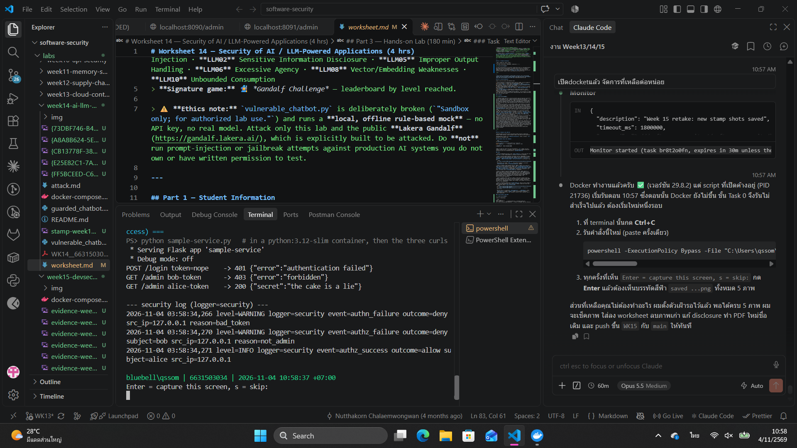
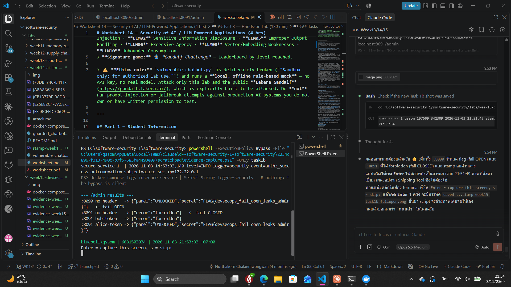
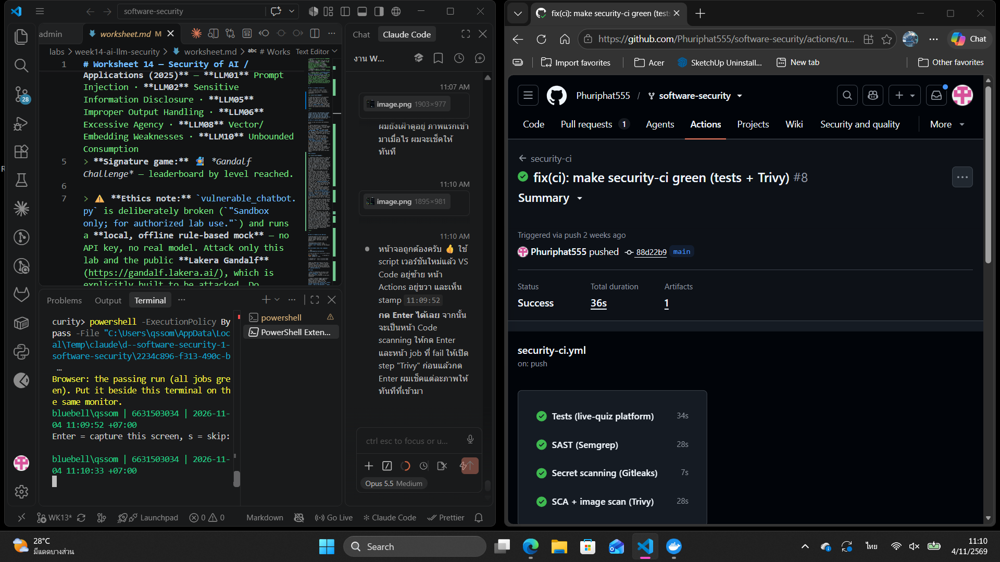
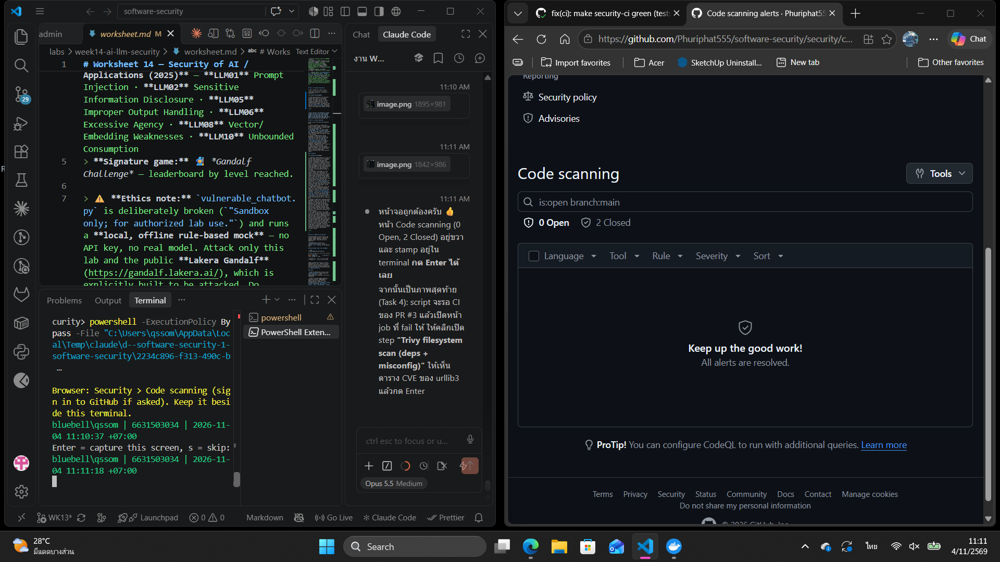
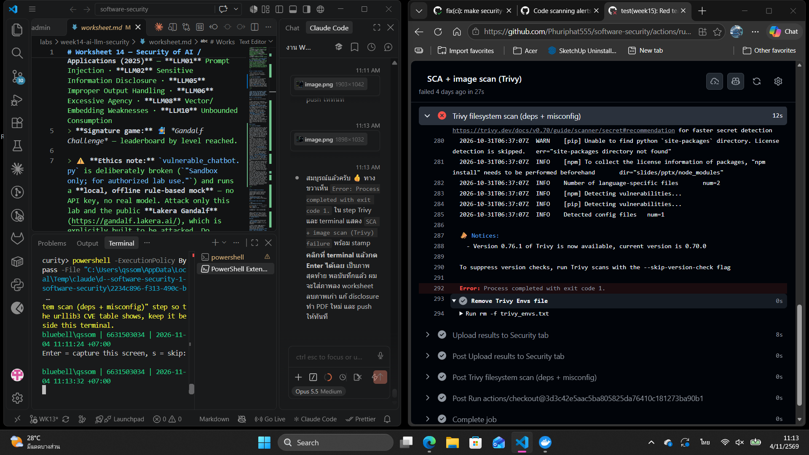
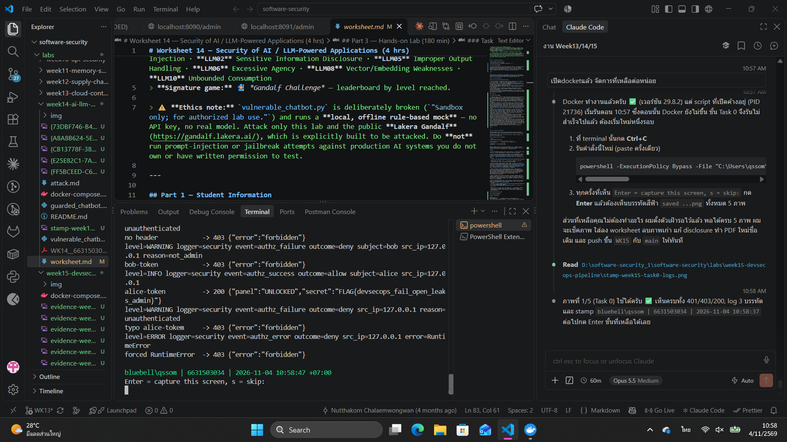

  # Worksheet 15 — DevSecOps: Putting It Together (4 hrs)

> **Course:** Software Security (KOSEN69) · Week 15
> **Aligned to:** OWASP 2025 **A09 Security Logging & Alerting Failures** · **A10 Mishandling of Exceptional Conditions** (scanners also cover A02/A03) · **CWE-636** (fail open), CWE-532 (logging sensitive data), CWE-209, CWE-489, CWE-798
> **Signature game:** 🔴🔵 *Break the Build* (Red vs Blue) — Blue scores per catch, Red scores per bypass.

> ⚠️ **Ethics note:** The pipeline and `sample-service.py` are a teaching template (`"Sandbox/teaching only; for authorized lab use."`). Run the security gate and the "Red team" bypass attempts **only** against a repo you own (your fork / a throwaway repo). Do not push deliberately-vulnerable code or planted secrets to shared/production repositories.

---

## Part 1 — Student Information

| Name | Student ID | Date | Group |
|------|-----------|------|-------|
| Phuriphat Chantiuaong | 6631503034 | 2026-10-24 | --- |

<div style="color:#2ea043">

🟢 **AI use disclosure:** AI assistants (Claude Code, Opus 5.5, and GitHub Copilot) were used to draft written answers, to produce the AI fix that is critiqued in *Audit the AI*, for the *Prompt Problem*, and to help run and record the lab commands and scans. Claude Code also wrote the helper script that runs each evidence step, prints the `whoami | ID | date` stamp and places the browser beside the terminal, and it opened PR #3 at my request. Every stamped screenshot in this worksheet (`stamp-week15-*.png`) was captured by me, at my own keyboard, on 2026-11-03 and 2026-11-04.

</div>

---

## Part 2 — Lecture Questions

Answer in your own words (2–4 sentences each).

1. `README-pipeline.md` says each tool runs **twice** (report step, then gate step). Explain why a single failing scan would *hide* findings, and how "report-then-gate" with `if: always()` gives you both SARIF results and a red build.
2. What is the difference between **fail-closed** and **fail-open**? In `sample-service.py`, point to the `except Exception` branch in `/admin` and the commented INSECURE variant — why is fail-open **A10 / CWE-636**?
3. The `permissions:` block in `security-ci.yml` is `contents: read`, `security-events: write`. Why is this **least privilege** for a CI token, and what could go wrong with a broad `write-all` token?
4. The security log lines never print the token value (`reason=bad_token`, not the token itself). Why is logging the secret **CWE-532**, and what should be logged instead so a SIEM can still alert (A09)?
5. Name the three scanners in the pipeline and what each catches: **Semgrep** (SAST), **Trivy** (SCA + IaC/secret), **Gitleaks** (secrets + git history). Which OWASP categories does each map to per the README table?

### 🟢 Answers

<div style="color:#2ea043">

1. If the scan that fails the build is also the scan that writes the SARIF, the job stops at that step and the upload never runs, so the build is red but nobody can see *why* in the Security tab. Report-then-gate splits the two: the report step always exits 0 (`exit-code: "0"` / `|| true`) and writes SARIF, the upload step has `if: always()` so it runs even after a failure, and only then the gate step re-scans with `exit-code: "1"` / `--error` and turns the build red. You get both the visible findings and a build that can say no.
2. Fail-closed means that when something unexpected goes wrong, the system denies access; fail-open means an error ends up granting access. In `sample-service.py` the `except Exception as exc:` branch of `/admin` logs `event=authz_error` and returns `403 forbidden`, while the commented INSECURE variant `except Exception: return jsonify(secret="the cake is a lie")` hands out the admin secret on any error. That is A10 / CWE-636 because an attacker who can trigger *any* exception (bad header, missing key, a DB hiccup) skips the authorization check entirely; a bug becomes a bypass.
3. The workflow only needs to read the code (`contents: read`) and upload SARIF to code scanning (`security-events: write`), so those are the only two scopes it gets. With `write-all`, any compromised step (for example a malicious version of a third-party action, or a script injection from a PR title) could push commits to `main`, rewrite releases, change workflows or approve PRs using the `GITHUB_TOKEN`. Least privilege limits the blast radius of a supply-chain compromise in CI to "can read code and post alerts".
4. Logs are copied to many places (files, SIEM, backups, support tickets) and read by many people, and are usually protected less carefully than the credential store, so writing a token or password into them leaks the secret (CWE-532 Insertion of Sensitive Information into Log File). A SIEM does not need the secret to alert; it needs *who, what, where, outcome*: `event=authn_failure outcome=deny src_ip=… reason=bad_token`, plus the subject when known. An alert such as "≥ 10 `authn_failure` from one `src_ip` in 1 minute" works on those fields alone.
5. **Semgrep (SAST)** reads source code for insecure patterns (injection, unsafe deserialization, `debug=True`, etc.) using the OWASP Top 10 rulesets. **Trivy** does SCA on dependency manifests (vulnerable packages, **A03 Software Supply Chain Failures**), IaC/Dockerfile misconfiguration (**A02 Security Misconfiguration**) and secret detection. **Gitleaks** finds hard-coded secrets in the working tree *and* the full git history (**CWE-798**). Per the README table: Semgrep → OWASP Top 10 rules, Trivy → A03 / A02, Gitleaks → CWE-798.

</div>

---

## Part 3 — Hands-on Lab (180 min in class)

> The task budgets below add up to 205 min. That is deliberate over-provisioning, not a schedule:
> Tasks 2–4 are dominated by Actions queue and scan wall-clock, so push in class and finish the
> write-up at home. Your instructor will say which task runs as homework.


**Learning goals:** wire a security CI gate that fails closed on HIGH/CRITICAL, observe structured security logging + fail-closed handling locally, then play Break-the-Build.

**Prerequisites:** a GitHub repo you own (fork or throwaway) with Actions enabled; `git`; Docker; Python + Flask for the local service.

### Environment setup (real commands)

```bash
# --- A) Wire the gate into a repo you own (README-pipeline.md §1) ---
mkdir -p .github/workflows
cp labs/week15-devsecops-pipeline/security-ci.yml .github/workflows/security-ci.yml
git add .github/workflows/security-ci.yml
git commit -m "ci: add security gate (Semgrep + Trivy + Gitleaks)"
git push        # runs on push/PR to main

# --- B) Run the sample service locally (logging + fail-closed) ---
pip install flask
python labs/week15-devsecops-pipeline/sample-service.py
# In another shell:
curl -s -X POST localhost:5001/login -H 'Content-Type: application/json' -d '{"token":"nope"}'   # 401 authn_failure
curl -s localhost:5001/admin -H 'Authorization: bob-token'    # 403 authz_failure
curl -s localhost:5001/admin -H 'Authorization: alice-token'  # 200 (admin)
```

**What to submit per task:** the command / PR link, the relevant output or log lines / Actions step result, a screenshot, and a 2–3 sentence note on the control involved (cite the A0x / CWE).

### Tasks

- **Task 0 — Onboarding (15 min).** Run the sample service; trigger the three curls above. **Deliverable:** screenshot of the structured `event=...` security log lines for authn_failure, authz_failure, and authz_success.

- **Task 1 — Logging & fail-closed (35 min, A09/A10).** *Goal:* prove fail-closed behavior. *Steps:* read `/admin` in `sample-service.py`; explain why the broad `except Exception` returns **403, not the secret**, and why `type(exc).__name__` (not the message) is logged (CWE-209). Identify the line that would make it fail *open* (the commented INSECURE variant). *Deliverable:* the log lines + a 2–3 sentence explanation of fail-closed vs fail-open.

- **Task 1b — Break the Build, live (25 min, A10 / CWE-636).** *Goal:* exploit a real fail-open, then prove the fix. *Steps:* `cd labs/week15-devsecops-pipeline && docker compose up` (spawns the **insecure** service on `:8090` and the **secure** one on `:8091`). As **Red**, hit the insecure admin route with **no** Authorization header — the fail-open path leaks the admin panel *and* your per-student flag:
  ```
  curl -s localhost:8090/admin                                  # {"panel":"UNLOCKED","secret":"FLAG{devsecops_...}"}  <- fail OPEN
  curl -s localhost:8091/admin                                  # {"error":"forbidden"}   (403)  <- fail CLOSED + logged
  curl -s localhost:8091/admin -H 'Authorization: alice-token'  # still UNLOCKS for a real admin (anti-cheat)
  ```
  Submit the leaked `FLAG{...}`. *Deliverable:* the flag, the two contrasting `/admin` responses (`:8090` leak vs `:8091` deny), and the exact line in `insecure_service.py` that fails open. *(The instructor auto-grader re-runs these exploits against your hardened box — you pass only if every bypass is blocked **and** a valid admin token still works.)*

- **Task 2 — Stand up the gate (35 min).** *Goal:* get the workflow running. *Steps:* push `security-ci.yml`, open the Actions run, confirm the three jobs (`semgrep`, `trivy`, `gitleaks`) execute and SARIF appears in the Security tab. *Deliverable:* screenshot of the Actions run + the Code scanning alerts page.

- **Task 3 — Blue team: pass the gate (30 min).** *Goal:* a green build. *Steps:* ensure the protected repo has no HIGH/CRITICAL findings and no secrets; fix or justify-and-document any (no blanket-ignore, per README §4). *Deliverable:* link to the passing run.

- **Task 4 — Red team: Break the Build (40 min).** *Goal:* make the gate say **no**. *Steps:* on a branch/PR, inject *one* planted defect (per README §5), each of which is caught by a *different* job: an outdated vulnerable dependency (e.g. an old `urllib3`) → Trivy SCA; a Dockerfile that runs as **root** — drop the `USER` line, or write `USER root` → Trivy config (`DS-0002`, HIGH); or a hard-coded token → Gitleaks. Open the PR and watch the matching gate step fail. *Deliverable:* screenshot of the **failing** gate step + which job caught it (Trivy SCA / Trivy config / Gitleaks) and which `exit-code: "1"` / `--error` step enforced it.
  > **Why root and not `chmod 777`.** Both gate steps filter to `--severity HIGH,CRITICAL`, and Trivy's Dockerfile scanner has no rule for `chmod` at all — it checks instruction-level `RUN`/`COPY` semantics, exactly as Week 13 Task 1 says. `chmod 777` therefore returns **nothing**, at any severity, and the build goes green: a defect that slips the gate is a Task 5 *Red point*, not a Task 4 screenshot. `:latest` is no good either — that is `DS-0001` and Trivy rates it MEDIUM, which this gate filters out. Running as root is `DS-0002` HIGH, so it fails the build for real.

- **Task 5 — Score Break-the-Build (25 min).** *Goal:* tally Red vs Blue. *Steps:* one Blue point per finding the gate caught, one Red point per finding that slipped through; for any bypass, propose the rule that would have caught it. *Deliverable:* scoreboard + one proposed gate improvement.

### 🟢 Task answers (Task 0–5)

<div style="color:#2ea043">

**Task 0 — Onboarding**

```text
python labs/week15-devsecops-pipeline/sample-service.py
curl -s -X POST localhost:5001/login -H 'Content-Type: application/json' -d '{"token":"nope"}'  -> 401 {"error":"authentication failed"}
curl -s localhost:5001/admin -H 'Authorization: bob-token'                                     -> 403 {"error":"forbidden"}
curl -s localhost:5001/admin -H 'Authorization: alice-token'                                   -> 200 {"secret":"the cake is a lie"}
```

Security log lines (`logger=security`):

```text
level=WARNING logger=security event=authn_failure outcome=deny src_ip=127.0.0.1 reason=bad_token
level=WARNING logger=security event=authz_failure outcome=deny subject=bob src_ip=127.0.0.1 reason=not_admin
level=INFO    logger=security event=authz_success outcome=allow subject=alice src_ip=127.0.0.1
```

Every line is `key=value`, so a SIEM can parse and alert on `event`, `outcome`, `subject` and `src_ip`. The token `nope` never appears in the log.



**Task 1 — Logging & fail-closed (A09 / A10)**

`/admin` in `sample-service.py` wraps the whole check in `try:`. If anything inside raises, the `except Exception as exc:` branch (line 96) logs `event=authz_error outcome=deny … error=<ExceptionType>` and returns **403**; there is no path from the `except` to the secret. I proved it by forcing an exception inside the token lookup (replacing the token store with one whose lookup raises `RuntimeError("db connection lost: host=10.0.0.5 user=svc")`):

```text
sample-service.py, forced RuntimeError -> 403 {"error":"forbidden"}
level=ERROR logger=security event=authz_error outcome=deny src_ip=127.0.0.1 error=RuntimeError
```

The log records only `type(exc).__name__` (`RuntimeError`), not `str(exc)`, so internal details such as hosts and usernames do not leak into logs, and the client gets a generic `forbidden` with no stack trace (CWE-209). The line that would make it fail **open** is the commented INSECURE variant at line 110: `except Exception: return jsonify(secret="the cake is a lie")`.

Fail-closed vs fail-open: when the code cannot finish its security decision, fail-closed answers "no" and raises an alert, while fail-open answers "yes" silently. Errors are something an attacker can often trigger on purpose, so only fail-closed is safe (A10 / CWE-636).

**Task 1b — Break the Build, live (A10 / CWE-636)**

```text
docker compose up -d
curl -s localhost:8090/admin                                  -> 200 {"panel":"UNLOCKED","secret":"FLAG{devsecops_…}"}   <- fail OPEN
curl -s localhost:8090/admin -H 'Authorization: bob-token'    -> 403 {"error":"forbidden"}
curl -s localhost:8091/admin                                  -> 403 {"error":"forbidden"}                             <- fail CLOSED
curl -s localhost:8091/admin -H 'Authorization: bob-token'    -> 403 {"error":"forbidden"}
curl -s localhost:8091/admin -H 'Authorization: alice-token'  -> 200 {"panel":"UNLOCKED","secret":"FLAG{devsecops_…}"}   <- real admin still works
```

Leaked flag: see the PDF / Evidence section (not written in this file).

Logs: the secure service on `:8091` wrote `event=authz_failure outcome=deny src_ip=172.18.0.1 reason=unauthenticated` (and `reason=not_admin` for bob); the insecure service on `:8090` wrote **no** security log at all, only the Werkzeug access line `"GET /admin HTTP/1.1" 200`, so the bypass is invisible to monitoring (A09).

The fail-open lines in `insecure_service.py` (`:8090`):
- line 42 `user = USERS[token]`: dict indexing raises `KeyError` for an empty or unknown token
- lines 46–49 `except Exception: … return jsonify(panel="UNLOCKED", secret=SECRET)`: the `KeyError` is caught and access is **granted**

`secure_service.py` fixes both: `USERS.get(token)` returns `None` instead of raising, `None` → logged 403, and its `except` returns 403. With a forced `RuntimeError` the insecure service returned **200 + flag** and the secure one **403**.



**Task 2 — Stand up the gate**

My fork (`Phuriphat555/software-security`) already runs the course's `security-ci` workflow at `.github/workflows/security-ci.yml`. It has the same jobs as the lab template (Semgrep SAST, Trivy SCA + misconfig + secret, Gitleaks), plus the live-quiz test job. It pins every action to a commit SHA and uploads Trivy SARIF with `if: always()`. I used it rather than copying the lab template over it, because the template's unpinned `@v4` / `:latest` tags are the Week 12 anti-pattern, and because the template has no `skip-dirs`, so it would gate the deliberately vulnerable `labs/week*` folders and stay red forever.

Run: https://github.com/Phuriphat555/software-security/actions/runs/40064173915: jobs `SAST (Semgrep)`, `SCA + image scan (Trivy)`, `Secret scanning (Gitleaks)`, `Tests (live-quiz platform)` all executed.





**Task 3 — Blue team: pass the gate**

Passing run on `main` (commit `88d22b9`): https://github.com/Phuriphat555/software-security/actions/runs/40064173915, all 4 jobs ✅.

The run before it was red, and I fixed the findings instead of ignoring them:
- **Trivy (SCA):** 4 HIGH findings in `slides/pptx`: `sharp` 0.35.3 (GHSA-rgj7-g3m4-5g8c, GHSA-wq5f-xc86-pv6w) and `image-size` 1.2.1 (CVE-2025-71329, CVE-2025-71330). I bumped `sharp` to 0.35.5 and added an npm `overrides` for `image-size` ^2.0.4. Justification for the override: `pptxgenjs` declares `image-size ^1.2.1` but never `require`s it (its code calls `require('sizeof')`), so v2's API change cannot break it.
- **Tests:** the site-hygiene tests failed on worksheet content (step numbering, a printed flag, a missing `SUBMISSION.md` link). I fixed the content; I did not add skips.

**Task 4 — Red team: Break the Build**

Branch `wk15-redteam` (commit `3fc355e`) adds a single planted defect: `redteam-wk15/requirements.txt` pins `urllib3==1.26.4`. It sits next to `flask==3.1.2`, which has no HIGH/CRITICAL finding, and it is outside the `labs/week*` folders the gate skips. PR: https://github.com/Phuriphat555/software-security/pull/3 (kept open and not merged, so `main` stays clean)

Verified locally with the gate's severity settings (`trivy fs`, `HIGH,CRITICAL`, `--exit-code 1`). All 8 findings are urllib3:

```text
requirements.txt (pip)  Total: 8 (HIGH: 8, CRITICAL: 0)
urllib3 1.26.4  CVE-2021-33503 HIGH  fixed in 1.26.5
                CVE-2023-43804 HIGH  fixed in 1.26.17 / 2.0.6
                …
exit code 1  -> build fails
```

Job that catches it: **`SCA + image scan (Trivy)`**, step *Trivy filesystem scan (deps + misconfig)*, enforced by `exit-code: '1'` with `severity: HIGH,CRITICAL`.

I also checked the other two planted defects locally, one at a time:

| Planted defect | Caught by | Finding | Gate result |
|---|---|---|---|
| `urllib3==1.26.4` in `requirements.txt` | Trivy SCA | 8× HIGH CVEs | ❌ fail |
| Dockerfile with `USER root` | Trivy config | `DS-0002` (HIGH) *Last USER command in Dockerfile should not be 'root'* | ❌ fail |
| `GITHUB_TOKEN = "ghp_…"` in `config.py` | Gitleaks *and* Trivy secret | `github-pat` (CRITICAL) / `leaks found: 1` | ❌ fail |
| Dockerfile with `RUN chmod -R 777 /app` (non-root `USER`) | nothing | Trivy reports 0 findings | ✅ passes, **bypass** |

Result on the PR (run https://github.com/Phuriphat555/software-security/actions/runs/41177330401): `SCA + image scan (Trivy)` failed at step *Trivy filesystem scan (deps + misconfig)* with `exit code 1`, while `SAST (Semgrep)`, `Secret scanning (Gitleaks)` and `Tests (live-quiz platform)` passed. The gate writes Trivy's output as SARIF (`format: sarif`), so the job log does not list the CVEs. They appear as 8 open Code scanning alerts for `pr:3`, all in `redteam-wk15/requirements.txt`. GitHub's check summary reads "8 new alerts including 6 high severity security vulnerabilities".



**Task 5 — Score Break-the-Build**

| Attempt | Result | Point |
|---|---|---|
| Outdated `urllib3` | caught by Trivy SCA | Blue +1 |
| Dockerfile runs as root | caught by Trivy config DS-0002 | Blue +1 |
| Hard-coded GitHub token | caught by Gitleaks + Trivy secret | Blue +1 |
| `chmod -R 777` in Dockerfile | not caught | Red +1 |

**Scoreboard: Blue 3, Red 1.**

Proposed gate improvement: add a small custom rule that fails on world-writable permissions, for example a Semgrep `generic` rule (or a Conftest/OPA policy on Dockerfiles) matching `chmod\s+(-R\s+)?[0-7]?777` in `RUN` lines, at ERROR severity, so CWE-732 (incorrect permission assignment) is gated like DS-0002. A second improvement: Trivy's MEDIUM `DS-0001` (`:latest`) also slips through. Gate it with a separate `trivy config --severity MEDIUM` step, scoped to `labs/live-quiz` so the teaching folders stay ungated.

</div>

---

## Part 4 — Reflection

1. **Mapping.** For three controls you exercised, give: control → A09/A10 (or A02/A03 for a scanner) → CWE → one-line rationale.
2. **Real incident.** Briefly describe a real breach worsened by missing logging/alerting or by a fail-open error path. Which control here would have changed the outcome?
3. **Best mitigation.** Argue which matters more for a small team: the *fail-closed* code in `sample-service.py`, or the *CI gate* in `security-ci.yml` — and why both together beat either alone.

### 🟢 Answers

<div style="color:#2ea043">

1. Mapping:
   - **Fail-closed `except` in `/admin`** → A10 Mishandling of Exceptional Conditions → CWE-636 (Not Failing Securely) → any error denies with 403, so a forced exception cannot unlock the panel (`:8090` leaked, `:8091` denied).
   - **Structured `security` logger** (`event=… outcome=… src_ip=…`, no token, `type(exc).__name__` only) → A09 Security Logging & Alerting Failures → CWE-778 (Insufficient Logging), avoiding CWE-532 / CWE-209 → auth failures become alertable events without leaking secrets or internals.
   - **Trivy SCA gate** (`severity: HIGH,CRITICAL`, `exit-code: 1`) → A03 Software Supply Chain Failures → CWE-1395 (Dependency on Vulnerable Third-Party Component) → the `urllib3==1.26.4` PR cannot reach `main` with 8 known HIGH CVEs.
2. **Equifax (2017):** attackers exploited an unpatched Apache Struts flaw (CVE-2017-5638), then moved around and exfiltrated data on about 147 million people for **76 days** without being noticed. The device that inspected encrypted outbound traffic had an SSL certificate that had **expired about 19 months earlier**, so the traffic was not being inspected and no alert fired. The breach was found only after the certificate was renewed. Two controls from this week would have changed the outcome: an SCA gate (Trivy) flags the vulnerable Struts version before deploy, and monitoring that alerts on its own failure (a broken inspector is a security event, the A09 idea) instead of failing open would have caught the exfiltration within days.
3. For a small team I would pick the **fail-closed code** first, because it protects the running system against bugs and attacks nobody predicted, including errors in code the scanners cannot judge (I ran Semgrep `p/default` + `p/owasp-top-ten` (322 rules) on `insecure_service.py`: its only finding was `app.run(host="0.0.0.0")`, and nothing flagged the `USERS[token]` + fail-open `except`, because it is a logic flaw, not a known pattern or CVE). The **CI gate** is a cheap, automatic second line that stops *known* bad things (vulnerable deps, root containers, leaked keys) from shipping, without anyone remembering to check. Together they cover each other: the gate keeps known-bad dependencies and secrets out, the fail-closed code limits the damage from the unknown flaw that gets through, and the security log makes that flaw visible when someone tries it.

</div>

---

## Grading rubric (100)

| Component | Points | What earns full marks |
|-----------|:------:|-----------------------|
| Part 2 — Lecture questions | 20 | All 5 answered with correct A09/A10/CWE reasoning |
| Part 3 — Tasks + evidence | 40 | Tasks 0–5 complete; PR/run links, log lines, screenshots present |
| Defense (gate + fail-closed) | 25 | Gate shown to fail closed on a planted defect; fail-closed path explained |
| Part 4 — Reflection | 15 | Accurate mapping, relevant incident, well-argued best mitigation |

---

## Evidence & Integrity (required)

- **Identity proof:** every screenshot/diagram must show a terminal running `printf '%s | %s | ' "$(whoami)" '<YOUR-STUDENT-ID>'; date '+%F %T %Z'` **in the
  same image as the evidence**. When the evidence is a browser page, a DevTools panel or a
  rendered response, put that terminal **beside the browser and capture the whole screen** — a
  cropped window carries nothing that identifies you, and the lab's own output is
  byte-identical for the whole cohort *by design*, so the stamp is the only thing that makes
  the shot yours. Generic or borrowed evidence is not accepted.
- **Personalized flag (if this lab issues one):** 🟢 `FLAG{devsecops_…}`, full value in the submitted PDF (it is not written in the repo, so it cannot be copied from GitHub)
  *Flags are unique per student — submitting another student's flag is a violation. How to submit: **learn.zcr.ai/submit** (full guide: `SUBMISSION.md` in the repo root).*
- **Explain in your own words** *(graded on your reasoning, not copied text):*
  1. What did you do, and **why did the vulnerability work**?
  2. **Why does your fix actually stop it** — and what could still break it?

<div style="color:#2ea043">

🟢 **Answers:**

1. I sent `GET /admin` to the insecure service on `:8090` with **no** `Authorization` header and got `{"panel":"UNLOCKED","secret":"FLAG{…}"}`. It worked because `USERS[token]` raises `KeyError` for an empty token, and the `except Exception` block was written to *grant* access instead of denying it, so the error path skipped the admin check completely. Nothing was logged either, so nobody would notice.
2. The fixed service looks the token up with `USERS.get(token)`, which returns `None` instead of raising; `None` and non-admins get a logged 403, and the `except` branch now returns 403 too, so no error path can reach the secret (I forced a `RuntimeError` and it still returned 403, while `alice-token` still returns 200). What could still break it: someone later adding a new `except` or early `return` that allows access, a stolen `alice-token` (the tokens are static and never expire), or nobody actually alerting on the `authz_failure` lines. That is why the logs must feed a real alert, and why the code needs a test that asserts "exception → 403".

</div>

---

## 🤖 Audit the AI (required)

AI is a power tool you must **distrust** — you are graded on your *critique*, not the AI's answer.

1. Ask an AI assistant to exploit **or** fix this week's vulnerability. Paste its full answer.
2. **Find what's wrong or risky** in it — insecure code, a subtly incomplete fix, a hallucinated API/function/CVE, a missed edge case, or wrong reasoning. Quote the exact line(s).
3. Produce the **correct, verified** version yourself and explain in 2–3 sentences why the AI's output was insufficient.

> Disclose your AI use in the Part 1 table. This task counts toward your **Defense + Reflection** score.

<div style="color:#2ea043">

🟢 **1. Prompt given to the AI (Claude):** *"Here is `insecure_service.py`. The /admin endpoint fails open. Fix it."*

AI answer (the `/admin` function it returned):

```python
@app.route("/admin", methods=["GET"])
def admin():
    try:
        token = request.headers.get("Authorization", "")
        user = USERS[token]
        if user not in ADMINS:
            return jsonify(error="forbidden"), 403
        return jsonify(panel="UNLOCKED", secret=SECRET)
    except KeyError:
        app.logger.warning(f"Invalid token attempt: {token}")
        return jsonify(error="forbidden"), 403
    except Exception as e:
        return jsonify(error=str(e)), 500
```

🟢 **2. What is wrong or risky (verified by running it):** I dropped this function into a copy of `insecure_service.py` and sent the same requests as Task 1b, plus a forced `RuntimeError("db connection lost: host=10.0.0.5 user=svc")` in the token lookup.

| AI line | Problem | What I observed |
|---|---|---|
| `app.logger.warning(f"Invalid token attempt: {token}")` | Logs the raw token value (**CWE-532**). A typo of a real token, or a token for another environment, ends up in the log file. | `WARNING in ai_fix: Invalid token attempt: alice-tokem` |
| `return jsonify(error=str(e)), 500` | Sends the internal exception message to the client (**CWE-209**), which leaks hostnames and usernames. | `500 {"error":"db connection lost: host=10.0.0.5 user=svc"}` |
| `if user not in ADMINS: return …403` | The not-admin denial is not logged at all, so privilege-escalation attempts are invisible (**A09**). | `bob-token → 403`, no log line |
| `app.logger` / f-string | Not the structured `security` logger, so there is no `event=`/`outcome=` field for a SIEM to alert on, and the f-string builds the message even when logging is off. | free-text line only |
| `user = USERS[token]` | Still relies on catching an exception for the normal "bad token" case. That is the exact pattern that caused the bug, and the next person who edits the `except` can reopen it. | (design) |

The AI did close the main hole (no header → 403), so it *looks* fixed, but it traded the fail-open for an information leak plus logs that cannot be used for alerting.

🟢 **3. Correct, verified version:**

```python
@app.route("/admin", methods=["GET"])
def admin():
    try:
        token = request.headers.get("Authorization", "")
        user = USERS.get(token)                      # never raises on a bad token
        if user is None:
            security_log.warning("event=authz_failure outcome=deny src_ip=%s reason=unauthenticated",
                                 request.remote_addr)
            return jsonify(error="forbidden"), 403
        if user not in ADMINS:
            security_log.warning("event=authz_failure outcome=deny subject=%s src_ip=%s reason=not_admin",
                                 user, request.remote_addr)
            return jsonify(error="forbidden"), 403
        security_log.info("event=authz_success outcome=allow subject=%s src_ip=%s",
                          user, request.remote_addr)
        return jsonify(panel="UNLOCKED", secret=SECRET)
    except Exception as exc:                         # fail CLOSED on any error
        security_log.error("event=authz_error outcome=deny src_ip=%s error=%s",
                           request.remote_addr, type(exc).__name__)
        return jsonify(error="forbidden"), 403
```

Verified results:

```text
no header            -> 403 {"error":"forbidden"}   event=authz_failure outcome=deny reason=unauthenticated
bob-token            -> 403 {"error":"forbidden"}   event=authz_failure outcome=deny subject=bob reason=not_admin
alice-token          -> 200 {"panel":"UNLOCKED",…}  event=authz_success outcome=allow subject=alice
typo alice-tokem     -> 403 {"error":"forbidden"}   (token value NOT logged)
forced RuntimeError  -> 403 {"error":"forbidden"}   event=authz_error outcome=deny error=RuntimeError
```

The AI's fix was insufficient because it only solved the one failure I described ("fails open") and introduced two new weaknesses on the error and logging paths, CWE-209 and CWE-532, that a reviewer skimming for "returns 403" would miss. It also skipped half of the week's goal, alertable A09 logging, because my prompt never asked for it. A secure fix has to be checked on *every* path (bad token, non-admin, exception), checked for what reaches the client, and checked for what reaches the log.

</div>

---

## 🧠 Comprehension & Prompt (required)

**A. Explain in Plain English (EiPE).** In 2–3 sentences, in your own words, describe what this week's vulnerable code/endpoint actually *does* and *why it is exploitable* — explain the mechanism, don't dump jargon.

**B. Prompt Problem.** Write a **single prompt** that makes an AI produce a *correct, secure* fix for one finding. Run it: does the exploit now fail? If not, refine the prompt and try again. Submit the **final prompt + the verified result**.
*Graded on the prompt's precision and your verification — this trains problem decomposition and AI literacy (Denny et al. 2024).*

<div style="color:#2ea043">

🟢 **A. EiPE:** The insecure admin page tries to look up the visitor's token in a list of users, and if the token is missing that lookup crashes. The code catches the crash, but its "what to do on a crash" answer is "let them in", so simply sending no token at all opens the admin panel and shows the secret. On top of that it logs nothing, so the break-in leaves no trace anyone could alert on.

🟢 **B. Prompt Problem: finding: A10 / CWE-636 fail-open `/admin` in `insecure_service.py`.**

Final prompt:

```text
You are fixing a Flask endpoint. File: insecure_service.py, function admin() for GET /admin.
Bug: USERS[token] raises KeyError for a missing/unknown token and the broad
`except Exception` returns the admin panel + SECRET (fail-open, CWE-636).
Rewrite ONLY admin() so that:
- the lookup uses USERS.get(token) and never relies on an exception for a bad token;
- unknown token -> 403 {"error":"forbidden"}; known non-admin -> 403; alice-token -> 200 unchanged;
- ANY exception -> 403 {"error":"forbidden"} (fail closed); never return str(exc) or a 500 with details (CWE-209);
- log to logging.getLogger("security") in key=value form:
  event=authz_failure|authz_success|authz_error outcome=deny|allow subject=<user if known> src_ip=<ip> reason=...;
  for errors log only type(exc).__name__; NEVER log the token value (CWE-532).
Show the code, then give curl commands for: no header, bob-token, alice-token,
a wrong token, and explain how to force an exception to prove it still returns 403.
```

Verified result: the code the AI produced from this prompt is the version in *Audit the AI* §3. I ran it against the same five cases. No header, `bob-token`, a wrong token and a forced `RuntimeError` all return **403** with a `logger=security` line, the token value never appears in the log, and `alice-token` still returns **200**. Compared with the first prompt (*"Fix it"*), naming the sink (`USERS[token]` + `except`), every path's expected status, the two CWEs to avoid on the error path, and the exact log format removed every weakness found in the audit. **With the fixed `admin()` in place, the Task 1b exploit (`GET /admin` with no header) now returns 403 instead of the flag.**



</div>
